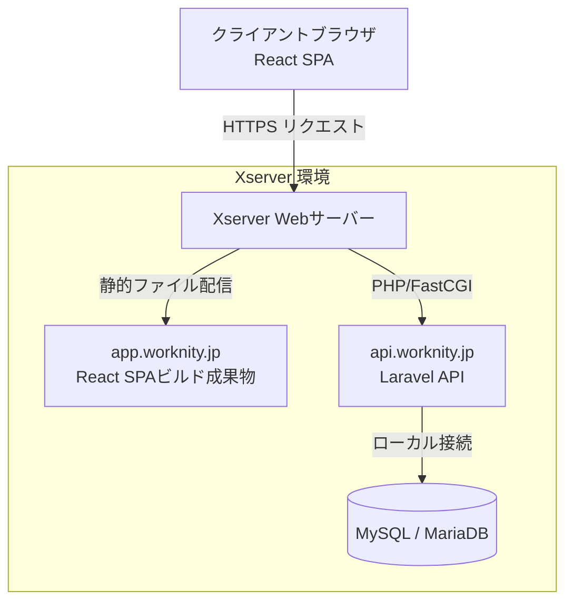

# システム要件：1. システムアーキテクチャ・技術スタック

本書は、ミニマリスト業務管理システム「Worknity（フェーズ1）」におけるシステムアーキテクチャ、インフラ構成、ディレクトリ構造、および将来的な拡張性の詳細仕様を定義する。

---

## 1. インフラ・システム構成

初期フェーズ（フェーズ1）では、開発スピードの最大化とインフラ保守・運用コストの最小化を最優先とし、共有レンタルサーバー環境である **Xserver（エックスサーバー）** 上にシステムを構築する。ただし、将来的なサービス規模の拡大に伴うインフラの移行（クラウド環境等への移行）を想定した疎結合な設計を原則とする。



### 1.1. サーバー環境仕様
* **本番環境サーバー：** Xserver（スタンダードプラン相当）
  * オペレーティングシステム：Linux（Xserver独自OS）
  * Webサーバー：Nginx（リバースプロキシ） + Apache
  * PHP実行環境：PHP 8.2+（FastCGI動作）
  * データベース：MySQL 8.0+ または MariaDB 10.5+
* **SSL/TLS暗号化通信：** Let's Encrypt による無料独自SSLをフロントエンドおよびバックエンドの双方に適用し、すべての通信を HTTPS（TLS 1.3推奨）で強制暗号化する。

### 1.2. ドメイン・サブドメイン設計
DNSレベルでフロントエンドとバックエンドのドメインを完全に切り分けることで、将来的にフロントエンドをCDN（Cloudflare、Vercel等）へ移行したり、バックエンドをAWS（EC2、ECS、RDS等）へ移行したりする作業をDNSレコードの変更のみで容易に行えるようにする。

* **本番ドメイン構成：**
  * **フロントエンド（クライアントアプリ）：** `https://app.worknity.jp`
    * ReactによるSPA（Single Page Application）のビルド成果物（HTML/CSS/JS）を配置。
  * **バックエンド（APIサーバー）：** `https://api.worknity.jp`
    * Laravelで構築されたREST API / MCP APIを配置。
* **CORS（Cross-Origin Resource Sharing）ポリシー：**
  * `api.worknity.jp` は、`app.worknity.jp`（および開発環境の `http://localhost:5173` 等）からのリクエストのみを許可するように制限する。

---

## 2. リポジトリ構成およびディレクトリ構造

リポジトリ管理の煩雑さを防ぎ、フロントエンドとバックエンドのコード変更をアトミック（不可分）に管理できるよう、**モノレポ（Monorepo）** 構成を採用する。

### 2.1. ディレクトリツリー
リポジトリルート配下の構造は以下の通り定義する。

```text
/ (Repository Root)
├── .github/                  # CI/CD パイプライン定義（GitHub Actions等）
├── apps/
│   └── main-app/             # フロントエンド（React / TypeScript / Vite）
│       ├── public/           # 静的アセット
│       ├── src/              # ソースコード（Components, Hooks, State, APIs）
│       ├── index.html
│       ├── package.json
│       ├── tsconfig.json
│       └── vite.config.ts
├── backend/                  # バックエンド（Laravel / PHP）
│   ├── app/                  # アプリケーション論理（Models, Controllers, Services）
│   ├── bootstrap/
│   ├── config/               # 設定ファイル群
│   ├── database/             # マイグレーション、シーダー、ファクトリ
│   ├── routes/               # ルーティング定義（api.php, mcp.php等）
│   ├── tests/                # 自動テストコード
│   ├── .env.example
│   ├── composer.json
│   └── artisan
└── README.md                 # 開発者向けセットアップガイド
```

### 2.2. 依存関係とビルドの独立性
* **独立したビルド：** フロントエンド（`apps/main-app`）とバックエンド（`backend`）は、それぞれ独立したパッケージマネージャー（npm/yarn/pnpm および Composer）とビルドパイプラインを持ち、お互いのビルド環境に依存しない。
* **ローカル開発環境：** 開発時はフロントエンド開発サーバー（Vite）とバックエンドローカルサーバー（Artisan serve等）を個別に起動して開発を行う。

---

## 3. 将来的な拡張性（仕込み要件）

フェーズ1の段階から、将来のアーキテクチャ移行や機能拡張をスムーズに行うための「仕込み」を実装ルールとして徹底する。

### 3.1. 環境変数の完全管理
* **ハードコーディングの禁止：** データベース接続情報、APIキー、各種エンドポイントURL、JWT署名鍵などの環境依存値は、絶対にソースコード内に直接記述（ハードコーディング）してはならない。
* **環境変数の利用：** フロントエンドでは `.env` ファイルおよび `import.meta.env` を、バックエンドでは `.env` ファイルおよび Laravel の `config()`・`env()` ヘルパーを必ず使用する。
* **インフラ移行の容易性：** これにより、将来データベースを共有サーバー内のMySQLから外部のフルマネージドサービス（AWS RDSやCloud SQLなど）へ移行する際も、ソースコードを変更せず環境変数の書き換えだけで対応可能となる。

### 3.2. AIサーバー連携（MCP：Model Context Protocol）の準備
将来的に、AIエージェントがシステム内のデータを検索したり、在庫のイン出庫等の操作を自律的に行えるようにするための通信窓口（MCP）をバックエンドにあらかじめ実装しておく。

* **通信窓口の独立性：** 一般のクライアント向けAPI（`/api/v1/...`）とはルーティングを分離し、`/mcp/v1/...` の専用パスで通信を受け付ける。
* **認証の統一：** MCP経由でのアクセスであっても、認証の仕組みは一般APIと同じJWT（JSON Web Token）を使用し、認証ロジックを共通化することでセキュリティ品質を保つ。
* 詳細は [3_機能要件.md](file:///d:/myApp/worknity/doc/システム要件/3_機能要件.md) のAI連携の項を参照。
