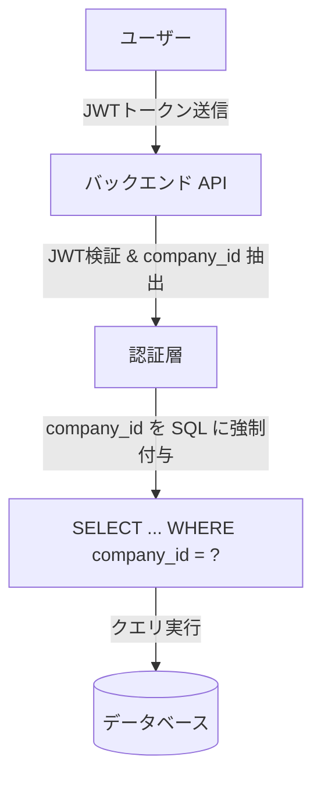

# システム要件：2. データベース要件

本書は、ミニマリスト業務統合サービス「Worknity（フェーズ1）」におけるデータベース設計、マルチテナント方式でのデータ隔離（データガード）、およびテーブル拡張方針に関するシステム要件を定義する。

詳細なスキーマ設計、カラム型、外部キー制約、および具体的なテーブル定義については、[データベース設計書.md](file:///d:/myApp/worknity/doc/データベース設計書.md) を参照すること。

---

## 1. データベース基本要件

本システムでは、マルチテナント形式（単一データベース・単一スキーマを全テナントで共有する方式）を採用する。

* **データベースエンジン：** MySQL 8.0+ / MariaDB 10.5+
  * 将来的なクラウド移行（AWS Aurora MySQL や RDS MySQL など）の際、移行エラーが発生しにくい標準的なSQL機能のみを使用する。
* **文字コード・照合順序（Collation）：**
  * 文字セット： `utf8mb4`
  * 照合順序： `utf8mb4_bin`
    * 理由：ユーザーのメールアドレスやパスワード、および企業IDなどの比較において、大文字・小文字、全角・半角、濁点・半濁点、絵文字の違いを厳密に区別するため。また、照合順序による意図しない認証バイパス等の脆弱性を防ぐため。
* **タイムゾーン管理：**
  * データベース内の日付時刻（`created_at`, `updated_at` 等）は、すべて **UTC（協定世界時）** を基準として記録する。
  * アプリケーション層（バックエンド/フロントエンド）に返却する際、または画面に表示する際に、利用者のローカルタイム（例: JST - 日本標準時）へ変換する。

---

## 2. マルチテナント（データガード）要件

本システムは、1つのデータベースに複数企業のデータが混在するマルチテナント方式であるため、他社データの閲覧・改ざんを完全に防ぐ「データガード（データ隔離）」の実装要件を最重要事項として定義する。

### 2.1. SQLクエリに対する自動フィルタリング
* **テナント制約の強制：** テナント依存テーブル（`users`, `stocks` など、最上位の `companies` を除くすべてのテーブル）へのクエリを発行する際、必ず `WHERE company_id = ?` の条件を適用しなければならない。
* **バックエンドフレームワークでの実装：**
  * Laravel を使用する場合、Eloquent の **グローバルスコープ（Global Scope）** を用いて、モデル操作時に自動的にログイン中ユーザーの `company_id` で条件が絞り込まれる機構を導入することを強く推奨する。これにより、実装漏れによる情報漏洩バグを防ぐ。
* **手動SQL/クエリビルダーの利用禁止：**
  * テナント分離ロジックを通さない生のSQLや、グローバルスコープを無効化したクエリの実行は、原則として厳しく制限し、コードレビュー時の必須確認項目とする。

### 2.2. 不正アクセス時のエラーハンドリング
* APIリクエストのパラメータ（例: `stocks.id`）で指定されたリソースが、リクエスト送信元の `company_id` に属していない場合は、以下の処理を行う。
  * **データ更新・削除の場合：** 認可エラー（`403 Forbidden`）を返却する。
  * **詳細参照の場合：** 対象データが存在しないものとして扱い、`404 Not Found` または `403 Forbidden` を返却する（IDの存在有無自体を隠蔽するためには `404` 推奨）。

---

## 3. テーブル要件とインデックス設計

マルチテナント環境下でクエリパフォーマンスを担保するため、インデックス設計の基準を定める。

### 3.1. インデックス設計原則
1. **テナントIDインデックスの必須化：**
   テナントに紐づくすべてのテーブルについて、`company_id` を先頭にしたインデックス（または複合インデックス）を必ず定義する。
2. **複合インデックスの優先：**
   テナント内で特定の商品名などを検索する頻度が高い場合、単一カラムのインデックスではなく、`(company_id, product_name)` のような複合インデックスを設定し、絞り込みをインデックススキャンのみで完結させる。

### 3.2. テーブル毎の要件概要
* **`companies`（企業マスタ）：**
  * 最上位エンティティ。他のテナント情報への依存はない。
* **`users`（ユーザーマスタ）：**
  * `company_id` に紐づく。ログインIDとして使用する `email` はシステム全体で一意（Unique Constraint）とする。
* **`stocks`（在庫マスタ）：**
  * `company_id` に紐づく。ユーザーと直接紐付けるのではなく企業に紐付けることで、同一企業内の複数スタッフでリアルタイムに同一の在庫データを管理・共有できるようにする。

---

## 4. JSON型（拡張属性 `attributes`）の設計・運用要件

`stocks` テーブルには、将来の業界特化型オプション（例: 食品、アパレル、精密機器）への拡張に対応するため、スキーマ変更なしで任意の属性を保持できる JSON型カラム `attributes` を定義する。

### 4.1. 運用ルール
* **スキーマレス運用の境界：**
  * 検索・ソートのキーとして頻繁に使用される共通項目（商品名、数量など）は、JSON内に含めず、物理的なカラムとして定義する。
  * 特定の業態（例: 食品における「賞味期限」、アパレルにおける「サイズ・カラー」）でのみ使用する補助的な項目のみを `attributes` 内に保存する。
* **バリデーション：**
  * データの整合性を担保するため、バックエンドAPIはリクエスト受信時に JSON内の特定のキーに対するバリデーション（JSON Schema等を用いたスキーマチェック、またはLaravelの配列バリデーションルール）を必ず実施する。
* **空値の扱い：**
  * 拡張機能が無効なテナントについては、`attributes` カラムは `NULL` または空のJSONオブジェクト `{}` をデフォルトとして登録する。
