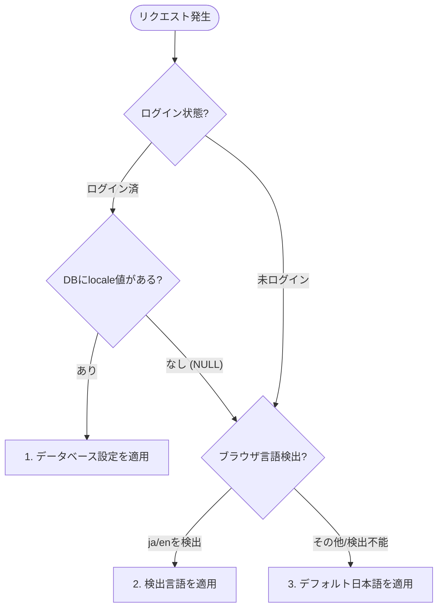

# システム要件：5. 多言語対応（i18n）要件

本書は、ミニマリスト業務統合サービス「Worknity（フェーズ1）」におけるシステム全体の多言語化（i18n / Internationalization）に関する共通仕様、ロケール決定ルール、およびUI設計指針を定義する。

---

## 1. 基本方針

本システムでは、グローバル展開および多様な国籍のスタッフによる利用を見据え、システム全体で一貫した多言語化対応を行う。

* **初期対応言語：** 日本語（`ja`）、英語（`en`）の2言語。
* **将来の拡張性：** 将来的な多国籍現場スタッフの参加に備え、ベトナム語、中国語、ネパール語等の言語を容易に追加・拡張できるコード・データベース設計とする。

---

## 2. ロケール（言語）決定ルール

表示言語は、ユーザーのログイン状態および優先設定に応じて以下の優先順位（優先度高 ➡ 低）で動的に決定する。



1. **ログイン状態における適用：**
   - ログインユーザーの場合、データベース（`users.locale`）に保存されている優先言語設定（`ja` / `en`）を最優先で適用する。
2. **未ログイン状態における適用（ログイン画面等）：**
   - クライアント側（React）は `navigator.language` または `navigator.languages` を検知する。
   - バックエンドAPI側は HTTP リクエストヘッダの `Accept-Language` を判別する。
3. **フォールバック（デフォルト）：**
   - 上記の判定で対応言語（`ja`/`en`）以外の言語が検出された場合、または検出に失敗した場合は、システムデフォルトロケールとして **日本語（`ja`）** を適用する。

---

## 3. 実装上の役割分担

### 3.1. フロントエンド（React / SPA）
* **翻訳辞書の管理：**
  * ボタン、画面内ラベル、プレースホルダー、説明文、および画面側バリデーション文言は、フロントエンドが管理するJSON形式の多言語辞書ファイル（例: `ja.json`, `en.json`）に定義する。
  * ライブラリには `i18next` および `react-i18next` などのデファクトスタンダードを使用する。
* **APIリクエスト時のヘッダ付与：**
  * バックエンドAPI（Laravel）への通信時、現在フロントエンドでアクティブな言語コード（`ja` または `en`）を `Accept-Language` ヘッダに常に付与して送信する。
  * `Authorization: Bearer <JWT>` と合わせて、以下のようにリクエストを構成する。
    ```http
    GET /api/v1/users HTTP/1.1
    Host: api.worknity.jp
    Authorization: Bearer <JWT_TOKEN>
    Accept-Language: en
    ```

### 3.2. バックエンド（Laravel / API）
* **APIエラーメッセージのローカライズ：**
  * APIから返却する各種エラーメッセージ（入力バリデーションエラーやビジネスルール違反）は、リクエストヘッダの `Accept-Language` をパースし、対応した言語で文言を組み立てて返却する。
* **システムメールのローカライズ：**
  * パスワードリセットメールや、将来的な新規ユーザー招待メール等を送信する際、対象ユーザーの優先言語（`users.locale`）に基づいて送信メールテンプレートを切り替える。
* **設定の同期と永続化：**
  * ユーザーがUI上で言語を手動切り替えした際、バックエンドAPI（`PUT /users/locale`）にて `locale` 値（`ja` または `en`）を受け取り、`users` テーブルの `locale` カラムを更新する。

---

## 4. UI設計・レイアウト崩れ防止指針

英語などマルチバイト文字でない言語を適用した際、文字列長が日本語と比較して **約1.5倍〜2倍** に伸長する場合がある。画面レイアウトの崩れ（折り返しによる位置ズレや切り切れ）を防ぐため、UI設計時に以下の実装方針を順守する。

* **Flexbox/Gridの活用（可変レイアウト）：**
  * 各UIコンポーネント（ボタン、入力欄、テーブルヘッダー）の横幅は極力固定（`width: 120px` など）にせず、`flex-grow` や `grid-template-columns`、あるいは適正な最小幅（`min-width`）を指定することで、文字列の長さに応じてレイアウトが自律調整されるようにする。
* **テキストクリッピング（省略表記）：**
  * メールアドレスや商品名などの可変長テキストは、想定外の改行でテーブル全体の行の高さが変わるのを防ぐため、以下のCSSを設定し末尾を三点リーダー（`...`）で切り捨てる仕様にする。
    ```css
    .text-truncate {
      white-space: nowrap;
      overflow: hidden;
      text-overflow: ellipsis;
    }
    ```
* **ボタンとラベルの十分な余白設計：**
  * ボタンに設定する余白（padding）は、テキストが長くなっても隣接する要素と重ならないよう、％や `em` などのフォントサイズ連動ユニットを用いて指定する。

---

## 5. 多言語リソーステキスト対照表（ユーザー管理機能での使用例）

システム共通語彙およびユーザー管理機能で用いる多言語キーの対照表を以下に示す。

| 翻訳キー (Translation Key) | 日本語 (ja) | 英語 (en) | 用途 |
| :--- | :--- | :--- | :--- |
| `nav.user_mgmt` | ユーザー管理 | User Management | ヘッダータイトル・メニュー |
| `user.add_staff` | 新しいスタッフを追加 | Add New Staff | スタッフ追加ボタン |
| `user.email` | メールアドレス / ログインID | Email / Login ID | テーブルヘッダー、入力プレースホルダー |
| `user.role` | 権限ロール | Role | テーブルヘッダー |
| `user.status` | アカウント状態 | Status | テーブルヘッダー |
| `user.role.admin` | 管理者 | Admin | 選択肢・バッジ |
| `user.role.staff` | スタッフ | Staff | 選択肢・バッジ |
| `user.role.guest` | ゲスト | Guest | 選択肢・バッジ |
| `user.status.active` | 有効 | Active | 状態バッジ |
| `user.status.suspended` | 一時停止 | Suspended | 状態バッジ |
| `user.action.delete` | 削除 | Remove | 操作ボタン |
| `user.action.disabled` | 非活性 | Disabled | 操作ボタン |
| `user.alert.last_admin` | 組織内にアクティブな管理者が少なくとも1人存在する必要があります。 | At least one active admin is required in the organization. | 警告ツールチップ・バリデーションエラー |
| `user.alert.delete_confirm` | この操作により、該当スタッフは組織データにアクセスできなくなりますが、過去の履歴データは保持されます。 | This action will revoke access to the organization data, but historical activity logs will be preserved. | 削除確認ダイアログ |
