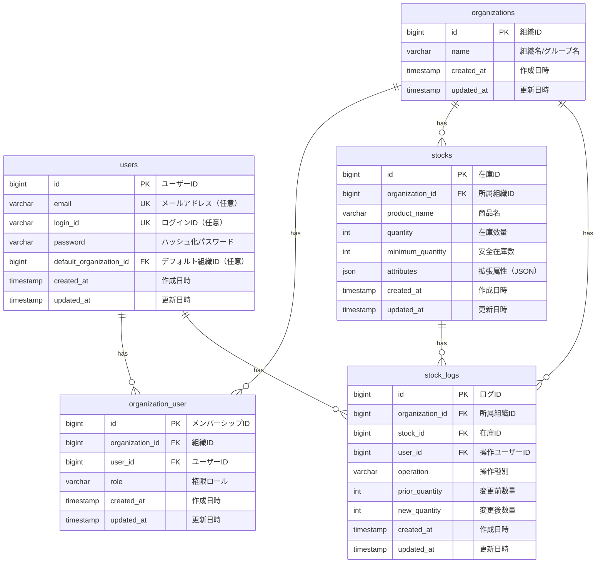

# データベース設計書

本書は、ミニマリスト業務統合サービス「Worknity（フェーズ1）」におけるデータベースの物理設計および仕様を定義するものである。

---

## 1. データベース概要

* **データベースエンジン：** MySQL 8.0+ / MariaDB 10.5+ を想定
* **文字セット（Charset）：** `utf8mb4` (絵文字およびマルチバイト文字対応)
* **照合順序（Collation）：** `utf8mb4_bin` (セキュリティおよび文字列の厳密な比較のためバイナリ比較を推奨)
* **タイムゾーン：** UTC (アプリケーション層で JST などのローカルタイムに変換)

---

## 2. ER図（Entity Relationship Diagram）



---

## 3. テーブル定義一覧

| 物理名 | 論理名 | 説明 |
| :--- | :--- | :--- |
| `organizations` | 組織マスタ | システムを利用する企業、チーム、団体、個人事業主（テナント）を管理する。 |
| `users` | ユーザーマスタ | ログイン可能なアカウント。メールアドレスまたはユーザーIDでログインする。 |
| `organization_user` | 組織メンバーシップ（中間テーブル） | ユーザーがどの組織にどの権限（ロール）で所属しているかを管理する。 |
| `stocks` | 在庫マスタ | 各組織が管理する在庫アイテムの情報。 |
| `stock_logs` | 在庫変動履歴ログ | 在庫の入出庫・棚卸・新規登録の変更履歴を管理する。 |

---

## 4. テーブル詳細設計

### 4.1. `organizations` テーブル（組織マスタ）

* **説明：** すべてのデータ構造の最上位となる「テナント（企業・チーム・団体・個人事業主）」を管理する。

#### カラム定義
| No | 物理名 | 論理名 | 型 | 長さ | Null | Key | デフォルト | 説明 |
| :--- | :--- | :--- | :--- | :--- | :--- | :--- | :--- | :--- |
| 1 | `id` | 組織ID | BIGINT | 20 | NO | PK | - | 自動採番 (Auto Increment, Unsigned) |
| 2 | `name` | 組織名/グループ名 | VARCHAR | 255 | NO | - | - | 企業名、チーム名、団体名、または事業主の屋号 |
| 3 | `created_at` | 作成日時 | TIMESTAMP | - | YES | - | NULL | レコード作成日時 |
| 4 | `updated_at` | 更新日時 | TIMESTAMP | - | YES | - | NULL | レコード更新日時 |

---

### 4.2. `users` テーブル（ユーザーマスタ）

* **説明：** ログイン可能なアカウント情報を管理する。メールアドレスまたはユーザーIDでログインする。

#### カラム定義
| No | 物理名 | 論理名 | 型 | 長さ | Null | Key | デフォルト | 説明 |
| :--- | :--- | :--- | :--- | :--- | :--- | :--- | :--- | :--- |
| 1 | `id` | ユーザーID | BIGINT | 20 | NO | PK | - | 自動採番 (Auto Increment, Unsigned) |
| 2 | `email` | メールアドレス | VARCHAR | 255 | YES | UK | NULL | ログインIDとして使用 (一意制約。Nullable) |
| 3 | `login_id` | ログインID | VARCHAR | 255 | YES | UK | NULL | ログイン用文字列ID (一意制約。Nullable) |
| 4 | `password` | パスワード | VARCHAR | 255 | NO | - | - | ハッシュ化されたパスワード文字列 |
| 5 | `default_organization_id` | デフォルト組織ID | BIGINT | 20 | YES | FK | NULL | ログイン時に自動選択される優先組織ID (Unsigned) |
| 6 | `created_at` | 作成日時 | TIMESTAMP | - | YES | - | NULL | レコード作成日時 |
| 7 | `updated_at` | 更新日時 | TIMESTAMP | - | YES | - | NULL | レコード更新日時 |

#### インデックス・外部キー制約
* **外部キー制約：**
  * `fk_users_default_organization_id` : `default_organization_id` -> `organizations(id)` (ON DELETE SET NULL / ON UPDATE CASCADE)
* **一意制約（Unique Key）：**
  * `uk_users_email` : `email` (メールアドレス重複防止)
  * `uk_users_login_id` : `login_id` (ユーザーID重複防止)

---

### 4.3. `organization_user` テーブル（組織メンバーシップ）

* **説明：** ユーザーがどの組織にどの権限（ロール）で所属しているかを管理する。

#### カラム定義
| No | 物理名 | 論理名 | 型 | 長さ | Null | Key | デフォルト | 説明 |
| :--- | :--- | :--- | :--- | :--- | :--- | :--- | :--- | :--- |
| 1 | `id` | メンバーシップID | BIGINT | 20 | NO | PK | - | 自動採番 (Auto Increment, Unsigned) |
| 2 | `organization_id` | 組織ID | BIGINT | 20 | NO | FK | - | `organizations.id` への外部キー (Unsigned) |
| 3 | `user_id` | ユーザーID | BIGINT | 20 | NO | FK | - | `users.id` への外部キー (Unsigned) |
| 4 | `role` | 権限ロール | VARCHAR | 50 | NO | - | - | `admin` (管理者) または `staff` (スタッフ) |
| 5 | `created_at` | 作成日時 | TIMESTAMP | - | YES | - | NULL | レコード作成日時 |
| 6 | `updated_at` | 更新日時 | TIMESTAMP | - | YES | - | NULL | レコード更新日時 |

#### インデックス・外部キー制約
* **外部キー制約：**
  * `fk_org_user_organization_id` : `organization_id` -> `organizations(id)` (ON DELETE CASCADE / ON UPDATE CASCADE)
  * `fk_org_user_user_id` : `user_id` -> `users(id)` (ON DELETE CASCADE / ON UPDATE CASCADE)
* **一意制約（Unique Key）：**
  * `uk_org_user_org_user` : `(organization_id, user_id)` (同一ユーザーの同一組織への多重登録防止)
* **インデックス：**
  * `idx_org_user_user_id` : `user_id` (ユーザーから所属組織を検索する高速化用)

---

### 4.4. `stocks` テーブル（在庫マスタ）

* **説明：** 各組織の在庫情報を管理する。ユーザー単位ではなく組織に直接紐付けることで、組織内の複数ユーザー間でリアルタイムに共有可能とする。

#### カラム定義
| No | 物理名 | 論理名 | 型 | 長さ | Null | Key | デフォルト | 説明 |
| :--- | :--- | :--- | :--- | :--- | :--- | :--- | :--- | :--- |
| 1 | `id` | 在庫ID | BIGINT | 20 | NO | PK | - | 自動採番 (Auto Increment, Unsigned) |
| 2 | `organization_id` | 所属組織ID | BIGINT | 20 | NO | FK | - | `organizations.id` への外部キー (Unsigned) |
| 3 | `product_name` | 商品名 | VARCHAR | 255 | NO | - | - | 管理対象の商品名 |
| 4 | `quantity` | 在庫数量 | INT | 11 | NO | - | 0 | 現在の在庫数。マイナス値も業務要件により許容する場合は符号付き、通常は 0 以上の整数。 |
| 5 | `minimum_quantity` | 安全在庫数 | INT | 11 | NO | - | 0 | 警告判定しきい値。在庫数がこの値を以下（かつ0より大きい）になると警告状態となる。 |
| 6 | `attributes` | 拡張属性 | JSON | - | YES | - | NULL | 将来の賞味期限、温度帯、保管場所等のための拡張領域 |
| 7 | `created_at` | 作成日時 | TIMESTAMP | - | YES | - | NULL | レコード作成日時 |
| 8 | `updated_at` | 更新日時 | TIMESTAMP | - | YES | - | NULL | レコード更新日時 |

#### インデックス・外部キー制約
* **外部キー制約：**
  * `fk_stocks_organization_id` : `organization_id` -> `organizations(id)` (ON DELETE RESTRICT / ON UPDATE CASCADE)
* **インデックス：**
  * `idx_stocks_organization_id` : `organization_id` (テナント検索の高速化用)
  * `idx_stocks_organization_product` : `(organization_id, product_name)` (テナント内での商品検索を高速化するための複合インデックス)

---

### 4.4. `stock_logs` テーブル（在庫変動履歴ログ）

* **説明：** 在庫の変更履歴をすべて記録する。監査証跡として利用し、フロントエンドの「7日間の動き（スパークライン）」のデータソースとしても使用する。

#### カラム定義
| No | 物理名 | 論理名 | 型 | 長さ | Null | Key | デフォルト | 説明 |
| :--- | :--- | :--- | :--- | :--- | :--- | :--- | :--- | :--- |
| 1 | `id` | ログID | BIGINT | 20 | NO | PK | - | 自動採番 (Auto Increment, Unsigned) |
| 2 | `organization_id` | 所属組織ID | BIGINT | 20 | NO | FK | - | `organizations.id` への外部キー (Unsigned) |
| 3 | `stock_id` | 在庫ID | BIGINT | 20 | NO | FK | - | `stocks.id` への外部キー (Unsigned) |
| 4 | `user_id` | 操作ユーザーID | BIGINT | 20 | YES | FK | NULL | `users.id` への外部キー (Unsigned)。退職等で削除された場合は NULL 許容。 |
| 5 | `operation` | 操作種別 | VARCHAR | 50 | NO | - | - | `create` (新規登録), `in` (入庫), `out` (出庫), `stocktake` (棚卸) |
| 6 | `prior_quantity` | 変更前数量 | INT | 11 | NO | - | 0 | 変更前の在庫数 |
| 7 | `new_quantity` | 変更後数量 | INT | 11 | NO | - | 0 | 変更後の在庫数（差分は `new_quantity - prior_quantity` で計算可能） |
| 8 | `created_at` | 作成日時 | TIMESTAMP | - | YES | - | NULL | レコード作成日時（操作日時に相当） |
| 9 | `updated_at` | 更新日時 | TIMESTAMP | - | YES | - | NULL | レコード更新日時 |

#### インデックス・外部キー制約
* **外部キー制約：**
  * `fk_stock_logs_organization_id` : `organization_id` -> `organizations(id)` (ON DELETE RESTRICT / ON UPDATE CASCADE)
  * `fk_stock_logs_stock_id` : `stock_id` -> `stocks(id)` (ON DELETE CASCADE / ON UPDATE CASCADE)
  * `fk_stock_logs_user_id` : `user_id` -> `users(id)` (ON DELETE SET NULL / ON UPDATE CASCADE)
* **インデックス：**
  * `idx_stock_logs_organization_stock` : `(organization_id, stock_id, created_at)` (特定の商品の直近履歴を高速に取得するための複合インデックス)

---

## 5. マルチテナント（データガード）設計とインデックス

本システムはマルチテナントSaaSであるため、バックエンドAPIはすべてのクエリで `WHERE organization_id = ?` による絞り込みを行う。この際のデータプライバシー確保とパフォーマンスを最大化するため、以下の設計原則を徹底する。

1. **インデックスの必須化：**
   `users` および `stocks` などのテナント配下のテーブルには、必ず第一引数に `organization_id` を配置したインデックス（あるいは複合インデックス）を付与する。
2. **複合インデックスの活用：**
   例えば在庫マスタで「組織内の特定商品」を検索する場合、`(organization_id, product_name)` の複合インデックスを設定することで、インデックススキャンのみで対象レコードを高速に特定できるようにする。

---

## 6. JSON型（拡張属性 `attributes`）のデータ構造定義例

`stocks.attributes` は、将来的に追加される特化型オプション（食品倉庫、アパレルなど）のデータを保持するためのJSON型カラムである。フェーズ1では基本的に `NULL` または空のJSON `{}` を許容するが、将来の拡張を見据えたデータ構造の例を以下に示す。

### 6.1. 食品倉庫特化オプション時のデータ構造例
```json
{
  "expiration_date": "2026-06-30",
  "temperature_zone": "frozen",
  "lot_number": "LOT-20260530-01",
  "storage_location": "冷凍ラック A-3"
}
```

### 6.2. アパレル特化オプション時のデータ構造例
```json
{
  "size": "L",
  "color": "Navy",
  "material": "Cotton 100%"
}
```
