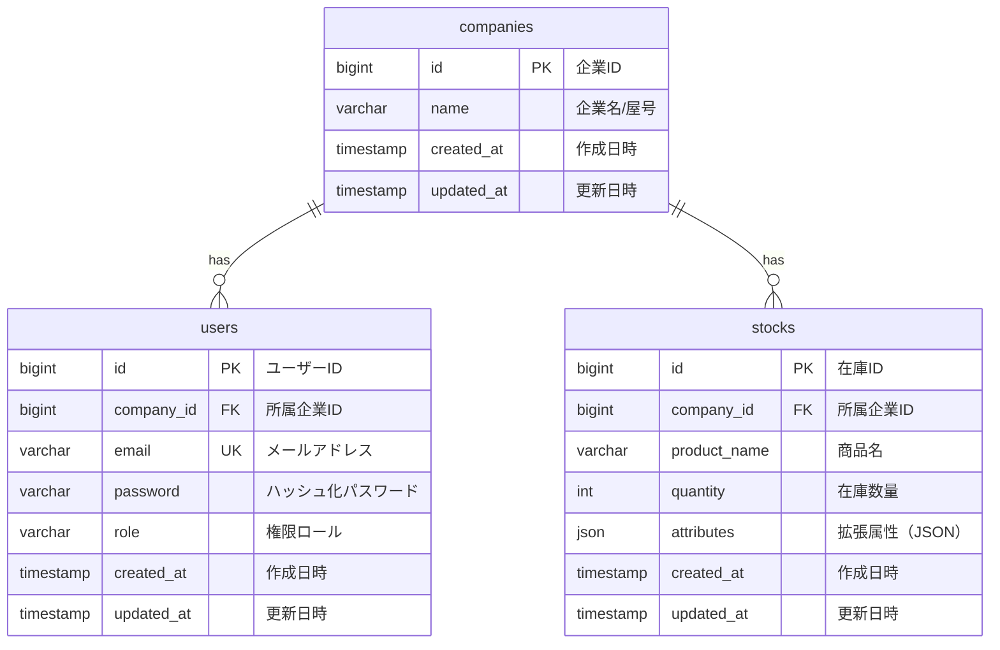

# データベース設計書

本書は、ミニマリスト業務管理システム「Worknity（フェーズ1）」におけるデータベースの物理設計および仕様を定義するものである。

---

## 1. データベース概要

* **データベースエンジン：** MySQL 8.0+ / MariaDB 10.5+ を想定
* **文字セット（Charset）：** `utf8mb4` (絵文字およびマルチバイト文字対応)
* **照合順序（Collation）：** `utf8mb4_bin` (セキュリティおよび文字列の厳密な比較のためバイナリ比較を推奨)
* **タイムゾーン：** UTC (アプリケーション層で JST などのローカルタイムに変換)

---

## 2. ER図（Entity Relationship Diagram）



---

## 3. テーブル定義一覧

| 物理名 | 論理名 | 説明 |
| :--- | :--- | :--- |
| `companies` | 企業マスタ | システムを利用する企業または個人事業主（テナント）を管理する。 |
| `users` | ユーザーマスタ | ログイン可能なユーザー情報。企業に所属し、管理権限を持つ。 |
| `stocks` | 在庫マスタ | 各企業が管理する在庫アイテムの情報。 |

---

## 4. テーブル詳細設計

### 4.1. `companies` テーブル（企業マスタ）

* **説明：** すべてのデータ構造の最上位となる「テナント（企業・団体・個人事業主）」を管理する。

#### カラム定義
| No | 物理名 | 論理名 | 型 | 長さ | Null | Key | デフォルト | 説明 |
| :--- | :--- | :--- | :--- | :--- | :--- | :--- | :--- | :--- |
| 1 | `id` | 企業ID | BIGINT | 20 | NO | PK | - | 自動採番 (Auto Increment, Unsigned) |
| 2 | `name` | 企業名/屋号 | VARCHAR | 255 | NO | - | - | 企業名または事業主の屋号 |
| 3 | `created_at` | 作成日時 | TIMESTAMP | - | YES | - | NULL | レコード作成日時 |
| 4 | `updated_at` | 更新日時 | TIMESTAMP | - | YES | - | NULL | レコード更新日時 |

---

### 4.2. `users` テーブル（ユーザーマスタ）

* **説明：** ログイン可能なユーザー情報を管理する。1つの企業に対して「1対多」で所属する。

#### カラム定義
| No | 物理名 | 論理名 | 型 | 長さ | Null | Key | デフォルト | 説明 |
| :--- | :--- | :--- | :--- | :--- | :--- | :--- | :--- | :--- |
| 1 | `id` | ユーザーID | BIGINT | 20 | NO | PK | - | 自動採番 (Auto Increment, Unsigned) |
| 2 | `company_id` | 所属企業ID | BIGINT | 20 | NO | FK | - | `companies.id` への外部キー (Unsigned) |
| 3 | `email` | メールアドレス | VARCHAR | 255 | NO | UK | - | ログインIDとして使用 (一意制約) |
| 4 | `password` | パスワード | VARCHAR | 255 | NO | - | - | ハッシュ化されたパスワード文字列 |
| 5 | `role` | 権限ロール | VARCHAR | 50 | NO | - | - | `admin` (管理者) または `staff` (スタッフ) |
| 6 | `created_at` | 作成日時 | TIMESTAMP | - | YES | - | NULL | レコード作成日時 |
| 7 | `updated_at` | 更新日時 | TIMESTAMP | - | YES | - | NULL | レコード更新日時 |

#### インデックス・外部キー制約
* **外部キー制約：**
  * `fk_users_company_id` : `company_id` -> `companies(id)` (ON DELETE RESTRICT / ON UPDATE CASCADE)
* **一意制約（Unique Key）：**
  * `uk_users_email` : `email` (一意)
* **インデックス：**
  * `idx_users_company_id` : `company_id` (テナント検索の高速化用)

---

### 4.3. `stocks` テーブル（在庫マスタ）

* **説明：** 各企業の在庫情報を管理する。ユーザー単位ではなく企業に直接紐付けることで、企業内の複数ユーザー間でリアルタイムに共有可能とする。

#### カラム定義
| No | 物理名 | 論理名 | 型 | 長さ | Null | Key | デフォルト | 説明 |
| :--- | :--- | :--- | :--- | :--- | :--- | :--- | :--- | :--- |
| 1 | `id` | 在庫ID | BIGINT | 20 | NO | PK | - | 自動採番 (Auto Increment, Unsigned) |
| 2 | `company_id` | 所属企業ID | BIGINT | 20 | NO | FK | - | `companies.id` への外部キー (Unsigned) |
| 3 | `product_name` | 商品名 | VARCHAR | 255 | NO | - | - | 管理対象の商品名 |
| 4 | `quantity` | 在庫数量 | INT | 11 | NO | - | 0 | 現在の在庫数。マイナス値も業務要件により許容する場合は符号付き、通常は 0 以上の整数。 |
| 5 | `attributes` | 拡張属性 | JSON | - | YES | - | NULL | 将来の賞味期限、温度帯、保管場所等のための拡張領域 |
| 6 | `created_at` | 作成日時 | TIMESTAMP | - | YES | - | NULL | レコード作成日時 |
| 7 | `updated_at` | 更新日時 | TIMESTAMP | - | YES | - | NULL | レコード更新日時 |

#### インデックス・外部キー制約
* **外部キー制約：**
  * `fk_stocks_company_id` : `company_id` -> `companies(id)` (ON DELETE RESTRICT / ON UPDATE CASCADE)
* **インデックス：**
  * `idx_stocks_company_id` : `company_id` (テナント検索の高速化用)
  * `idx_stocks_company_product` : `(company_id, product_name)` (テナント内での商品検索を高速化するための複合インデックス)

---

## 5. マルチテナント（データガード）設計とインデックス

本システムはマルチテナントSaaSであるため、バックエンドAPIはすべてのクエリで `WHERE company_id = ?` による絞り込みを行う。この際のデータプライバシー確保とパフォーマンスを最大化するため、以下の設計原則を徹底する。

1. **インデックスの必須化：**
   `users` および `stocks` などのテナント配下のテーブルには、必ず第一引数に `company_id` を配置したインデックス（あるいは複合インデックス）を付与する。
2. **複合インデックスの活用：**
   例えば在庫マスタで「企業内の特定商品」を検索する場合、`(company_id, product_name)` の複合インデックスを設定することで、インデックススキャンのみで対象レコードを高速に特定できるようにする。

---

## 6. JSON型（拡張属性 `attributes`）のデータ構造定義例

`stocks.attributes` は、将来的に追加される特化型オプション（食品倉庫、アパレルなど）のデータを保持するためのJSON型カラムである。フェーズ1では基本的に `NULL` または空のJSON `{}` を許容するが、将来の拡張を見据えたデータ構造の例を以下に示す。

### 6.1. 食品倉庫特化オプション時のデータ構造例
```json
{
  "expiration_date": "2026-06-30",
  "temperature_zone": "frozen",
  "lot_number": "LOT-20260530-01",
  "storage_location": "冷凍ラック A-3"
}
```

### 6.2. アパレル特化オプション時のデータ構造例
```json
{
  "size": "L",
  "color": "Navy",
  "material": "Cotton 100%"
}
```
