# データベース設計書

本書は、ミニマリスト業務統合サービス「Worknity（フェーズ1）」におけるデータベースの物理設計および仕様を定義するものである。

---

## 1. データベース概要

* **データベースエンジン：** MySQL 8.0+ / MariaDB 10.5+ を想定
* **文字セット（Charset）：** `utf8mb4` (絵文字およびマルチバイト文字対応)
* **照合順序（Collation）：** `utf8mb4_bin` (セキュリティおよび文字列の厳密な比較のためバイナリ比較を推奨)
* **タイムゾーン：** UTC (アプリケーション層で JST などのローカルタイムに変換)

---

## 2. ER図（Entity Relationship Diagram）

```mermaid
erDiagram
    organizations ||--o{ organization_user : "has"
    users ||--o{ organization_user : "has"
    organizations ||--o{ stocks : "has"
    organizations ||--o{ stock_logs : "has"
    stocks ||--o{ stock_logs : "has"
    users ||--o{ stock_logs : "has"
    organizations ||--o{ attendances : "has"
    users ||--o{ attendances : "has"
    organizations ||--o{ attendance_requests : "has"
    users ||--o{ attendance_requests : "has"
    organizations ||--o{ partners : "has"
    organizations ||--o{ projects : "has"
    organizations ||--o{ tasks : "has"
    organizations ||--o{ calendar_holidays : "has"
    projects ||--o{ tasks : "has"
    users ||--o{ tasks : "assigned"
    tasks ||--o{ task_repeat_rules : "has"
    tasks ||--o{ task_comments : "has"
    users ||--o{ task_comments : "posted"
    
    organizations ||--o{ approval_classes : "has"
    organizations ||--o{ user_approval_classes : "has"
    organizations ||--o{ report_templates : "has"
    organizations ||--o{ report_approval_routes : "has"
    organizations ||--o{ reports : "has"
    organizations ||--o{ report_approvals : "has"
    users ||--o{ user_approval_classes : "belongs to"
    approval_classes ||--o{ user_approval_classes : "has"
    approval_classes ||--o{ report_approval_routes : "has"
    report_templates ||--o{ report_approval_routes : "has"
    report_templates ||--o{ reports : "has"
    users ||--o{ reports : "submits"
    reports ||--o{ report_approvals : "has"
    users ||--o{ report_approvals : "approves"
    
    %% 共通ワークフローエンジン連携（ポリモーフィック）
    reports }o--o| orders : "approves (polymorphic)"
    reports }o--o| attendance_requests : "approves (polymorphic)"

    %% 発注管理モジュール
    organizations ||--|| order_settings : "has"
    report_templates ||--o{ order_settings : "defines"
    organizations ||--o{ orders : "has"
    partners ||--o{ orders : "receives"
    orders ||--o{ order_items : "has"
    stocks ||--o{ order_items : "included"

    organizations {
        bigint id PK "組織ID"
        varchar name "組織名/グループ名"
        timestamp created_at "作成日時"
        timestamp updated_at "更新日時"
    }

    users {
        bigint id PK "ユーザーID"
        varchar email UK "メールアドレス（任意）"
        varchar login_id UK "ログインID（任意）"
        varchar password "ハッシュ化パスワード"
        varchar locale "優先言語 (ja/en)"
        bigint default_organization_id FK "デフォルト組織ID（任意）"
        timestamp created_at "作成日時"
        timestamp updated_at "更新日時"
    }

    organization_user {
        bigint id PK "メンバーシップID"
        bigint organization_id FK "組織ID"
        bigint user_id FK "ユーザーID"
        varchar role "権限ロール"
        varchar status "アカウント状態 (active/suspended)"
        timestamp created_at "作成日時"
        timestamp updated_at "更新日時"
    }

    stocks {
        bigint id PK "在庫ID"
        bigint organization_id FK "所属組織ID"
        varchar product_name "商品名"
        int quantity "在庫数量"
        int minimum_quantity "安全在庫数"
        json attributes "拡張属性（JSON）"
        varchar jan_code "JANコード"
        text description "商品説明・仕様"
        varchar image_url "画像URL"
        int price "参考価格"
        varchar brand_name "ブランド・メーカー名"
        varchar category_name "カテゴリ名"
        timestamp created_at "作成日時"
        timestamp updated_at "更新日時"
    }

    partners {
        bigint id PK "取引先ID"
        bigint organization_id FK "所属組織ID"
        varchar name "取引先名"
        varchar address "住所"
        varchar phone "電話番号"
        timestamp created_at "作成日時"
        timestamp updated_at "更新日時"
    }

    stock_logs {
        bigint id PK "ログID"
        bigint organization_id FK "所属組織ID"
        bigint stock_id FK "在庫ID"
        bigint user_id FK "操作ユーザーID"
        varchar operation "操作種別"
        int prior_quantity "変更前数量"
        int new_quantity "変更後数量"
        varchar partner_name "取引先名"
        varchar partner_address "取引先住所"
        varchar partner_phone "取引先電話番号"
        timestamp created_at "作成日時"
        timestamp updated_at "更新日時"
    }

    attendances {
        bigint id PK "勤怠ID"
        bigint organization_id FK "所属組織ID"
        bigint user_id FK "ユーザーID"
        date work_date "勤務日"
        datetime clock_in "出勤時刻"
        datetime clock_out "退勤時刻"
        int break_minutes "休憩時間"
        varchar status "ステータス"
        timestamp created_at "作成日時"
        timestamp updated_at "更新日時"
    }

    attendance_requests {
        bigint id PK "申請ID"
        bigint organization_id FK "所属組織ID"
        bigint user_id FK "申請者ユーザーID"
        varchar type "申請種別"
        varchar status "承認ステータス"
        date target_date "対象日"
        datetime requested_clock_in "希望出勤時刻"
        datetime requested_clock_out "希望退勤時刻"
        int requested_break_minutes "希望休憩時間"
        varchar leave_type "休暇種別"
        text reason "理由"
        bigint approved_by FK "承認者ユーザーID"
        datetime approved_at "承認日時"
        timestamp created_at "作成日時"
        timestamp updated_at "更新日時"
    }

    projects {
        bigint id PK "プロジェクトID"
        bigint organization_id FK "組織ID"
        varchar name "プロジェクト名"
        text description "詳細説明"
        varchar status "ステータス"
        date start_date "開始予定日"
        date end_date "終了予定日"
        int budget_hours "想定工数"
        timestamp created_at "作成日時"
        timestamp updated_at "更新日時"
    }

    tasks {
        bigint id PK "タスクID"
        bigint organization_id FK "組織ID"
        bigint project_id FK "プロジェクトID"
        varchar name "タスク名"
        text description "詳細説明"
        bigint assignee_id FK "担当者ID"
        varchar status "ステータス"
        date due_date "期限日"
        decimal planned_hours "予定工数"
        decimal actual_hours "実績工数"
        timestamp created_at "作成日時"
        timestamp updated_at "更新日時"
    }

    task_repeat_rules {
        bigint id PK "ルールID"
        bigint organization_id FK "組織ID"
        bigint task_id FK "タスクID"
        varchar pattern "パターン"
        json details "詳細設定JSON"
        varchar non_working_day_behavior "非稼働日挙動"
        timestamp created_at "作成日時"
        timestamp updated_at "更新日時"
    }

    task_comments {
        bigint id PK "コメントID"
        bigint organization_id FK "組織ID"
        bigint task_id FK "タスクID"
        bigint user_id FK "投稿ユーザーID"
        text content "本文"
        varchar importance "重要度"
        varchar type "種類"
        bigint related_task_id FK "関連タスクID"
        timestamp created_at "作成日時"
        timestamp updated_at "更新日時"
    }

    calendar_holidays {
        bigint id PK "休日ID"
        bigint organization_id FK "組織ID"
        date holiday_date UK "休日日付"
        varchar name "休日名"
        timestamp created_at "作成日時"
        timestamp updated_at "更新日時"
    }

    approval_classes {
        bigint id PK "クラスID"
        bigint organization_id FK "組織ID"
        varchar name "クラス名"
        int priority "優先度(序列)"
        timestamp created_at "作成日時"
        timestamp updated_at "更新日時"
    }

    user_approval_classes {
        bigint id PK "ID"
        bigint organization_id FK "組織ID"
        bigint user_id FK "ユーザーID"
        bigint approval_class_id FK "承認者クラスID"
        timestamp created_at "作成日時"
        timestamp updated_at "更新日時"
    }

    report_templates {
        bigint id PK "テンプレートID"
        bigint organization_id FK "組織ID"
        varchar name "テンプレート名"
        text description "説明文"
        varchar type "テンプレート種別"
        int steps_count "承認ステップ数"
        json fields "入力項目定義"
        timestamp created_at "作成日時"
        timestamp updated_at "更新日時"
    }

    report_approval_routes {
        bigint id PK "ルートID"
        bigint organization_id FK "組織ID"
        bigint report_template_id FK "テンプレートID"
        int step_number "ステップ番号"
        varchar approver_type "承認指定タイプ"
        bigint approval_class_id FK "承認者クラスID"
        bigint approver_user_id FK "承認ユーザーID"
        timestamp created_at "作成日時"
        timestamp updated_at "更新日時"
    }

    reports {
        bigint id PK "データID"
        bigint organization_id FK "組織ID"
        bigint report_template_id FK "テンプレートID"
        bigint user_id FK "作成ユーザーID"
        varchar status "ステータス"
        int current_step "現在のステップ"
        json attributes "入力値データ"
        varchar approvable_type "ポリモーフィック連携モデル (例: App\Models\Order)"
        bigint approvable_id "ポリモーフィック連携データID (例: orders.id)"
        timestamp created_at "作成日時"
        timestamp updated_at "更新日時"
    }

    order_settings {
        bigint id PK "設定ID"
        bigint organization_id FK "組織ID"
        tinyint require_approval "承認必須フラグ"
        int approval_threshold "承認しきい値金額"
        bigint report_template_id FK "申請テンプレートID"
        timestamp created_at "作成日時"
        timestamp updated_at "更新日時"
    }

    orders {
        bigint id PK "発注ID"
        bigint organization_id FK "組織ID"
        bigint partner_id FK "取引先ID"
        varchar order_number "発注番号"
        date order_date "発注日"
        date delivery_deadline "希望納期"
        varchar status "ステータス (draft/pending_approval/ordered/etc.)"
        bigint created_by FK "担当者ID"
        timestamp created_at "作成日時"
        timestamp updated_at "更新日時"
    }

    order_items {
        bigint id PK "明細ID"
        bigint organization_id FK "組織ID"
        bigint order_id FK "発注ID"
        bigint stock_id FK "在庫ID"
        int quantity "発注数量"
        int received_quantity "入荷済数量"
        int unit_price "発注単価"
        timestamp created_at "作成日時"
        timestamp updated_at "更新日時"
    }

    report_approvals {
        bigint id PK "履歴ID"
        bigint organization_id FK "組織ID"
        bigint report_id FK "申請データID"
        int step_number "対象ステップ番号"
        bigint user_id FK "処理ユーザーID"
        varchar action "アクション"
        text comment "コメント"
        timestamp created_at "作成日時"
        timestamp updated_at "更新日時"
    }
```

---

## 3. テーブル定義一覧

| 物理名 | 論理名 | 移動先・説明 |
| :--- | :--- | :--- |
| `organizations` | 組織マスタ | ➡ [マスタ管理 データベース設計書](file:///home/ubuntu/worknity/_doc/機能/マスタ管理/データベース設計.md#31-organizations-テーブル組織マスタ) |
| `users` | ユーザーマスタ | ➡ [マスタ管理 データベース設計書](file:///home/ubuntu/worknity/_doc/機能/マスタ管理/データベース設計.md#32-users-テーブルユーザーマスタ) |
| `organization_user` | 組織メンバーシップ | ➡ [マスタ管理 データベース設計書](file:///home/ubuntu/worknity/_doc/機能/マスタ管理/データベース設計.md#33-organization_user-テーブル組織メンバーシップ) |
| `stocks` | 在庫マスタ | ➡ [マスタ管理 データベース設計書](file:///home/ubuntu/worknity/_doc/機能/マスタ管理/データベース設計.md#34-stocks-テーブル在庫マスタ) |
| `partners` | 取引先マスタ | ➡ [マスタ管理 データベース設計書](file:///home/ubuntu/worknity/_doc/機能/マスタ管理/データベース設計.md#35-partners-テーブル取引先マスタ---新規設計) |
| `stock_logs` | 在庫変動履歴ログ | ➡ [在庫管理 データベース設計書](file:///home/ubuntu/worknity/_doc/機能/在庫管理/データベース設計.md#31-stock_logs-テーブル在庫変動履歴ログ) |
| `attendances` | 勤怠データ | 本書 (下部詳細設計参照) |
| `attendance_requests` | 打刻・休暇申請データ | 本書 (下部詳細設計参照) |
| `projects` | プロジェクトマスタ | ➡ [プロジェクト管理 データベース設計書](file:///home/ubuntu/worknity/_doc/機能/プロジェクト管理/データベース設計.md) |
| `tasks` | タスク | ➡ [タスク管理 データベース設計書](file:///home/ubuntu/worknity/_doc/機能/タスク管理/データベース設計.md#31-tasks-テーブルタスク) |
| `task_repeat_rules` | タスク繰り返し設定 | ➡ [タスク管理 データベース設計書](file:///home/ubuntu/worknity/_doc/機能/タスク管理/データベース設計.md#32-task_repeat_rules-テーブル繰り返し設定) |
| `task_comments` | タスクコメント・申し送り | ➡ [タスク管理 データベース設計書](file:///home/ubuntu/worknity/_doc/機能/タスク管理/データベース設計.md#33-task_comments-テーブルタスクコメント申し送り) |
| `calendar_holidays` | 組織カレンダー休日 | ➡ [タスク管理 データベース設計書](file:///home/ubuntu/worknity/_doc/機能/タスク管理/データベース設計.md#34-calendar_holidays-テーブル組織カレンダー休日) |
| `approval_classes` | 承認者クラス | ➡ [申請報告管理 データベース設計書](file:///home/ubuntu/worknity/_doc/機能/申請報告管理/データベース設計.md#31-approval_classes-テーブル-承認者クラス) |
| `user_approval_classes` | ユーザー承認者クラス紐付け | ➡ [申請報告管理 データベース設計書](file:///home/ubuntu/worknity/_doc/機能/申請報告管理/データベース設計.md#32-user_approval_classes-テーブル-ユーザー承認者クラス紐付け) |
| `report_templates` | 申請報告テンプレート | ➡ [申請報告管理 データベース設計書](file:///home/ubuntu/worknity/_doc/機能/申請報告管理/データベース設計.md#33-report_templates-テーブル-申請報告テンプレート) |
| `report_approval_routes` | 承認ルート定義 | ➡ [申請報告管理 データベース設計書](file:///home/ubuntu/worknity/_doc/機能/申請報告管理/データベース設計.md#34-report_approval_routes-テーブル-承認ルート定義) |
| `reports` | 申請報告データ | ➡ [申請報告管理 データベース設計書](file:///home/ubuntu/worknity/_doc/機能/申請報告管理/データベース設計.md#35-reports-テーブル-申請報告データ) |
| `report_approvals` | 承認・却下履歴 | ➡ [申請報告管理 データベース設計書](file:///home/ubuntu/worknity/_doc/機能/申請報告管理/データベース設計.md#36-report_approvals-テーブル-承認・却下履歴) |

---

## 4. テーブル詳細設計

* 各基盤マスタ（`organizations`, `users`, `organization_user`, `stocks`, `partners`）の詳細設計については、[マスタ管理 データベース設計書](file:///home/ubuntu/worknity/_doc/機能/マスタ管理/データベース設計.md) を参照すること。
* 在庫変動履歴（`stock_logs`）および拡張属性（`attributes`）の設計については、[在庫管理 データベース設計書](file:///home/ubuntu/worknity/_doc/機能/在庫管理/データベース設計.md) を参照すること。

---

### 4.1. `attendances` テーブル（勤怠データ）

* **説明：** 各組織のスタッフの毎日の勤怠データを管理する。

#### カラム定義
| No | 物理名 | 論理名 | 型 | 長さ | Null | Key | デフォルト | 説明 |
| :--- | :--- | :--- | :--- | :--- | :--- | :--- | :--- | :--- |
| 1 | `id` | 勤怠ID | BIGINT | 20 | NO | PK | - | 自動採番 (Auto Increment, Unsigned) |
| 2 | `organization_id` | 所属組織ID | BIGINT | 20 | NO | FK | - | `organizations.id` への外部キー (Unsigned) |
| 3 | `user_id` | ユーザーID | BIGINT | 20 | NO | FK | - | `users.id` への外部キー (Unsigned) |
| 4 | `work_date` | 勤務日 | DATE | - | NO | - | - | 勤務対象日 (Y-m-d) |
| 5 | `clock_in` | 出勤時刻 | DATETIME | - | YES | - | NULL | 出勤打刻日時 |
| 6 | `clock_out` | 退勤時刻 | DATETIME | - | YES | - | NULL | 退勤打刻日時 |
| 7 | `break_minutes` | 休憩時間（分） | INT | 11 | NO | - | 0 | 休憩時間の合計（分） |
| 8 | `status` | 勤務状況ステータス | VARCHAR | 50 | NO | - | 'working' | 'working' (出勤中), 'completed' (退勤済), 'absent' (欠勤), 'leave' (休暇) |
| 9 | `created_at` | 作成日時 | TIMESTAMP | - | YES | - | NULL | レコード作成日時 |
| 10 | `updated_at` | 更新日時 | TIMESTAMP | - | YES | - | NULL | レコード更新日時 |

#### インデックス・外部キー制約
* **外部キー制約：**
  * `fk_attendances_organization_id` : `organization_id` -> `organizations(id)` (ON DELETE CASCADE / ON UPDATE CASCADE)
  * `fk_attendances_user_id` : `user_id` -> `users(id)` (ON DELETE CASCADE / ON UPDATE CASCADE)
* **一意制約（Unique Key）：**
  * `uk_attendances_org_user_date` : `(organization_id, user_id, work_date)` (1ユーザー1日1レコード制限)
* **インデックス：**
  * `idx_attendances_organization_id` : `organization_id` (テナント検索の高速化用)
  * `idx_attendances_org_date` : `(organization_id, work_date)` (組織の月次勤怠集計高速化用)

---

### 4.2. `attendance_requests` テーブル（打刻・休暇申請データ）

* **説明：** 打刻の修正申請や休暇申請を管理する。本テーブルの承認フローは共通ワークフローエンジン（`reports`）に移譲され、承認結果（ステータスや承認者情報）は `reports` からの同期イベントによって本テーブルへミラーリング（自動更新）されます。

#### カラム定義
| No | 物理名 | 論理名 | 型 | 長さ | Null | Key | デフォルト | 説明 |
| :--- | :--- | :--- | :--- | :--- | :--- | :--- | :--- | :--- |
| 1 | `id` | 申請ID | BIGINT | 20 | NO | PK | - | 自動採番 (Auto Increment, Unsigned) |
| 2 | `organization_id` | 所属組織ID | BIGINT | 20 | NO | FK | - | `organizations.id` への外部キー (Unsigned) |
| 3 | `user_id` | 申請ユーザーID | BIGINT | 20 | NO | FK | - | `users.id` への外部キー (Unsigned) |
| 4 | `type` | 申請種別 | VARCHAR | 50 | NO | - | - | 'correction' (打刻修正), 'leave' (休暇申請) |
| 5 | `status` | 承認ステータス | VARCHAR | 50 | NO | - | 'pending' | 'pending' (未処理/承認待ち), 'approved' (承認済), 'rejected' (却下済) ※`reports` のステータスと自動連動 |
| 6 | `target_date` | 対象日 | DATE | - | NO | - | - | 修正または休暇の対象日 |
| 7 | `requested_clock_in` | 修正後出勤時刻 | DATETIME | - | YES | - | NULL | 修正申請時の希望出勤日時 |
| 8 | `requested_clock_out` | 修正後退勤時刻 | DATETIME | - | YES | - | NULL | 修正申請時の希望退勤日時 |
| 9 | `requested_break_minutes` | 修正後休憩（分） | INT | 11 | YES | - | NULL | 修正申請時の希望休憩時間 |
| 10 | `leave_type` | 休暇種別 | VARCHAR | 50 | YES | - | NULL | 'paid' (有給), 'unpaid' (無給), 'special' (特別休暇) |
| 11 | `reason` | 申請理由 | TEXT | - | YES | - | NULL | 申請理由テキスト |
| 12 | `approved_by` | 承認者ユーザーID | BIGINT | 20 | YES | FK | NULL | 承認/却下を行った管理者のID ※`reports` の最終承認ユーザーと自動連動 |
| 13 | `approved_at` | 承認日時 | DATETIME | - | YES | - | NULL | 承認/却下が行われた日時 ※`reports` の最終承認日時と自動連動 |
| 14 | `created_at` | 作成日時 | TIMESTAMP | - | YES | - | NULL | 申請日時 |
| 15 | `updated_at` | 更新日時 | TIMESTAMP | - | YES | - | NULL | レコード更新日時 |

#### インデックス・外部キー制約
* **外部キー制約：**
  * `fk_requests_organization_id` : `organization_id` -> `organizations(id)` (ON DELETE CASCADE / ON UPDATE CASCADE)
  * `fk_requests_user_id` : `user_id` -> `users(id)` (ON DELETE CASCADE / ON UPDATE CASCADE)
  * `fk_requests_approved_by` : `approved_by` -> `users(id)` (ON DELETE SET NULL / ON UPDATE CASCADE)
* **インデックス：**
  * `idx_requests_organization_id` : `organization_id`
  * `idx_requests_org_status` : `(organization_id, status)` (管理者の未承認申請リスト取得用)

---

## 5. マルチテナント（データガード）設計とインデックス

本システムはマルチテナントSaaSであるため、バックエンドAPIはすべてのクエリで `WHERE organization_id = ?` による絞り込みを行う。この際のデータプライバシー確保とパフォーマンスを最大化するため、以下の設計原則を徹底する。

1. **インデックスの必須化：**
   `users` および `stocks` などのテナント配下のテーブルには、必ず第一引数に `organization_id` を配置したインデックス（あるいは複合インデックス）を付与する。
2. **複合インデックスの活用：**
   例えば在庫マスタで「組織内の特定商品」を検索する場合、`(organization_id, product_name)` の複合インデックスを設定することで、インデックススキャンのみで対象レコードを高速に特定できるようにする。
