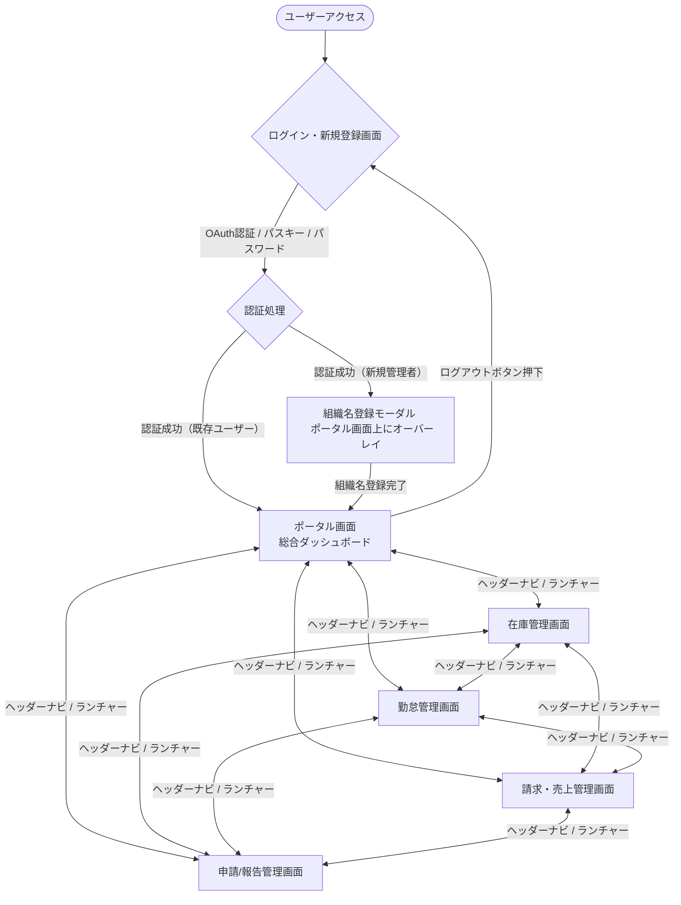

# 基本設計書（システム基本設計）

本書は、ミニマリスト業務統合サービス「Worknity（フェーズ1）」におけるシステム全体の基本設計を定義する。本書は開発におけるマスタードキュメントであり、各領域の詳細設計は個別ドキュメントを参照する。

---

## 1. 本書の目的

本書は、[要件定義書](file:///home/ubuntu/worknity/_doc/要件定義書.md) および [システム要件定義書](file:///home/ubuntu/worknity/_doc/システム要件.md) に基づき、システムの全体構成、画面、機能、データベース、API、および非機能要件の設計基準を定める。開発チームがコード実装およびテストを行う上での共通の指針とすることを目的とする。

---

## 2. システム概要

「人・物・金」にまつわる業務の「複雑さ・面倒さ」を排除し、認知負荷ゼロで日々の運用を継続できる、ミニマリストなマルチテナント型SaaS。
初期フェーズ（フェーズ1）では、すべての特化型サービスの基盤となる「超シンプルなユーザー・企業管理」および「入出庫・棚卸に絞った在庫管理」の基本機能を最速で立ち上げる。

* **対象ユーザー**: 小規模事業者、個人事業主（管理者 `admin` および 一般スタッフ `staff`）
* **コア価値**: ログイン後の即時操作性、認知負荷の徹底排除、いつでも1秒で無効化できる安心感。

詳細は、[要件定義書.md](file:///home/ubuntu/worknity/_doc/要件定義書.md) を参照。

---

## 3. システム構成・技術スタック

本システムは、初期インフラコストを最小限に抑えつつ、将来的な拡張・インフラ分離（クラウド移行）が容易に行える疎結合設計を採用する。

* **サーバー構成**: Xserver（1台）による単一DB・マルチテナント構成。
* **ドメイン設計**: フロントエンドとバックエンドをサブドメインで物理的に分離。
  * フロントエンド（React SPA）: `https://app.worknity.jp`
  * バックエンド（Laravel API）: `https://api.worknity.jp`
* **リポジトリ構成**: 1つのリポジトリでコードをアトミックに管理する **モノレポ（Monorepo）** 構成を採用。
  * クライアントアプリ領域: `/apps/main-app/`
  * APIサーバー領域: `/backend/`

詳細は、[1_システムアーキテクチャ.md](file:///home/ubuntu/worknity/_doc/システム要件/1_システムアーキテクチャ.md) を参照。

---

## 4. 画面設計・画面遷移

Worknityは全画面キオスクスタイル（縦スクロールなし・100vh固定）を採用し、ヘッダー左上にWorknityロゴ、その隣に各機能のアイコンとラベルが一体化したモダンな横並びコンパクトタブ（ピル型ハイライト付き、幅溢れ時は滑らかな横スクロール対応）を配置することで、1クリックで目的の機能モジュールへ直接遷移できる効率的かつ洗練されたUXを提供します。全機能のアイコンは統一されたSVGベクターアイコンで構成され、選択中タブは `var(--primary-light)` の背景と `var(--primary)` のテキスト・アイコンで優しく強調されます（モバイル表示時は、左端のクイックランチャーボタン `[⋮⋮⋮]` を介して、タッチ操作しやすいオーバーレイメニューが展開されます）。ヘッダー右端には、登録されたプロフィール画像（写真やイラスト、`avatar.png`）を円形（42x42px、`border-radius: 50%`）に切り抜いたアバターボタンを配置し、クリックすることでユーザー情報、所属組織の切り替え、セキュリティ設定、ダークモード切り替え、およびログアウトをまとめたコンテキストメニュー（ドロップダウン）が表示されるスッキリとした構成を採用しています。

### 4.1. 提供画面一覧
1. **ログイン・新規登録画面**: ソーシャルログイン、パスキー（生体認証）、パスワード認証を統合した認証画面。
   * 詳細仕様: [ログイン画面.md](file:///home/ubuntu/worknity/_doc/画面設計/ログイン/ログイン画面.md)
2. **ポータル画面（総合ダッシュボード）**: 各種契約機能モジュールの要約ウィジェット（勤怠打刻、在庫健康状態、売上進捗）が一覧表示される総合ホーム画面。
3. **在庫管理画面（個別モジュール）**: 画面遷移なし（ゼロ・コンテキストスイッチ）の2ペインシステム。左側のアクション領域（伝票入力、棚卸しスプレッドシート、変動履歴タイムライン）と、右側のマスター在庫一覧を統合した単一画面。
   * 詳細仕様: [3_機能要件.md](file:///home/ubuntu/worknity/_doc/システム要件/3_機能要件.md#L49-L100)
4. **勤怠管理画面（個別モジュール - モック）**: タイムカードおよび勤務記録管理画面。
5. **請求・売上管理画面（個別モジュール - モック）**: 請求書・売上推移管理画面。
6. **申請・報告管理画面（個別モジュール）**: 各種申請（稟議等）や報告（日報等）の入力、段階的入力ワークフローの管理、および承認を行う画面。
   * 詳細仕様: [機能仕様.md](file:///home/ubuntu/worknity/_doc/機能/申請報告管理/機能仕様.md)

### 4.2. 画面遷移図

---

## 5. 機能詳細設計

### 5.1. 認証・ユーザー管理機能
* **JWT（JSON Web Token）マルチテナント認証**:
  * ログイン成功時にJWT（有効期限1時間）を発行し、React SPAはこれをメモリ上でのみ保持してリクエストヘッダ（`Authorization: Bearer`）に付与する。
  * 画面リロード対策として、セキュアCookieを用いたサイレントトークンリフレッシュ、または自動ログイン処理を実装する。
* **新規テナントセットアップ**:
  * ソーシャルログイン等による初回サインアップ時、自動で `organizations` および `users`（ロール: `admin`）を生成し、初期組織名設定を求めるモーダルを表示する。
* **管理者によるユーザー追加（アプローチA）**:
  * `admin`（管理者）は「ユーザー追加フォーム」から、スタッフのメールアドレス、初期パスワードを入力してその場でスタッフ（`role` は一律 `staff`）を追加できる.
  * 追加されたユーザーには、管理者と同じ `organization_id` が自動で割り当てられる。

詳細は、[3_機能要件.md](file:///home/ubuntu/worknity/_doc/システム要件/3_機能要件.md#L7-L47) を参照。

### 5.2. 在庫管理機能（コア機能）
* **2-Pane Systemによる画面遷移なしの統合操作**:
  * 右ペインに「マスター在庫一覧（2/3幅）」、左ペインに「アクション領域（1/3幅）」を固定配置する。
* **入出庫処理（Mode A & B）**:
  * 右ペインの商品クリックで左ペインの「入出庫伝票」に行が追加され、数量を入力後、一括で確定する。
  * 確定時に、データの流れの方向（入庫：左から右 `→`、出庫：右から左 `←`）を示す矢印にCSSマイクロアニメーションを付加する。
* **棚卸し処理（Mode C）**:
  * 右ペインを薄暗くロック（opacity: 0.4, pointer-events: none）し、左ペインにスプレッドシート風の「棚卸入力シート」を展開。
  * キーボードの `[Enter]` キーによる連続入力・フォーカス自動移動（Focus Management）。
  * 確定行は右ペインでハイライト（スポットライト）され、実在庫と理論在庫の不一致（MATCH: 白, SHORTAGE: 青, SURPLUS: 赤）により3色判定背景色が適用される。
  * 不一致（異常）が発生した行は、左ペインの最上部へ自動でソートされる（動的CSSトランジション）。
* **入出庫履歴（Mode D）**:
  * 右ペインで選択された商品の変動ログ（履歴）を時系列でタイムライン表示する（`/api/stocks/{id}/history` からフェッチ）。
* **多重更新（レースコンディション）対策**:
  * 在庫の加減算・棚卸時、トランザクション内で `SELECT ... FOR UPDATE` (悲観的ロック) を実行し、並行プロセスによる不整合（ロストアップデート）を防止する。

詳細は、[3_機能要件.md](file:///home/ubuntu/worknity/_doc/システム要件/3_機能要件.md#L49-L100) を参照。

### 5.3. AI（MCP：Model Context Protocol）連携機能
将来のAIエージェントによる自動操作・検索を見据え、MCP規格に準拠したAPIエンドポイントを先行実装する。

* **提供エンドポイント**:
  * `POST /mcp/v1/tools/list` (実行可能なツールの定義リストをJSON Schemaで返却)
  * `POST /mcp/v1/tools/call` (AIからの命令で実際の在庫更新ロジックを実行)
  * `POST /mcp/v1/resources/list` (AI向けに安全にフィルタリングされた在庫サマリーを提供)
* **誤操作防止（Human-in-the-loop）**:
  * AIが `tools/call` を呼び出す前に、フロントエンド上で「実行承認」ダイアログを挟み、人間のオペレーターによる明示的な承諾（クリック）を経て初めてDB更新を確定する。

詳細は、[3_機能要件.md](file:///home/ubuntu/worknity/_doc/システム要件/3_機能要件.md#L79-L132) を参照。

### 5.4. 申請・報告管理機能
ユーザーが自由に項目（フォーマット）を定義して、日常の記録や申請（日報、稟議、旅費等）を行い、段階的な承認ルート（最大3ステップ）で処理する機能。

* **自由なフォーマット設計**:
  * テキスト、数値、日付、選択肢、画像・ファイル添付などを動的JSONでテンプレート化。
* **柔軟な承認者クラス（役職）設定**:
  * テナントごとに自由に承認用の役職（例：「副部長」「部長」「先生」「経理」など）を定義可能。
* **段階的入力と承認フロー**:
  * 承認ステップごとに担当の「ユーザー」または「承認者クラス」を割り当てる。
  * 「承認されたら次の枠に入力可能にする」というワークフローをサポート。
* **二重更新防止**:
  * 承認処理時、トランザクション内で悲観的ロック (`lockForUpdate`) を使用しデータの整合性を保証。

詳細は、[機能仕様.md](file:///home/ubuntu/worknity/_doc/機能/申請報告管理/機能仕様.md) を参照。

---

## 6. データベース設計概要

データプライバシーの保護とパフォーマンス、および将来の機能拡張性を両立させるデータベース設計を行う。

* **データベース仕様**: MySQL 8.0+ / MariaDB 10.5+、文字セット `utf8mb4`、照合順序 `utf8mb4_bin`、タイムゾーン UTC。
* **テーブル構成**:
  * `organizations`（組織マスタ）: システムを利用するテナント（組織・グループ）情報。
  * `users`（ユーザーマスタ）: ログイン可能なユーザーアカウント（`organizations` に対し 1:N 紐付け）。
  * `stocks`（在庫マスタ）: 組織が管理する在庫アイテム（`organizations` に対し 1:N 紐付け）。
  * `stock_logs`（在庫変動履歴ログ）: 在庫の変動履歴（`organizations` に対し 1:N 紐付け）。
  * `approval_classes`（承認者クラス）: 組織独自の承認用の役職マスタ（`organizations` に対し 1:N 紐付け）。
  * `user_approval_classes`（ユーザー承認者クラス紐付け）: 各ユーザーへの承認者クラス割り当て中間テーブル（`organizations` に対し 1:N 紐付け）。
  * `report_templates`（申請報告テンプレート）: 申請/報告の入力フォームやフローの定義（`organizations` に対し 1:N 紐付け）。
  * `report_approval_routes`（承認ルート定義）: テンプレートごとの承認ステップ設定（`organizations` に対し 1:N 紐付け）。
  * `reports`（申請報告データ）: 実際の申請/報告の入力データをJSON型で保持（`organizations` に対し 1:N 紐付け）。
  * `report_approvals`（承認・却下履歴）: 各ステップの承認および却下の履歴（`organizations` に対し 1:N 紐付け）。
* **マルチテナント隔離（データガード）**:
  * テナント依存テーブル（`users`, `stocks`, `reports`, `approval_classes` 等）への全クエリに `WHERE organization_id = ?` を自動適用する（Laravel Eloquent のグローバルスコープを使用）。
  * `organization_id` を先頭に配置した複合インデックス（例: `(organization_id, product_name)`）を定義し、検索を高速化する。
* **拡張属性（`attributes` JSON型カラム）**:
  * 業態ごとの個別ニーズ（賞味期限、温度帯、サイズ等）は、物理スキーマを変更せずに `stocks.attributes`（JSON型）内に保存・管理する。
  * 申請/報告機能における動的なフォームの入力値も `reports.attributes`（JSON型）を使用して柔軟に保持・管理する。

詳細は、[データベース設計書.md](file:///home/ubuntu/worknity/_doc/データベース設計書.md) および [2_データベース要件.md](file:///home/ubuntu/worknity/_doc/システム要件/2_データベース要件.md) を参照。

---

## 7. API設計概要

フロントエンドおよびAIエージェントと、バックエンドAPI間の通信仕様を統一する。

* **ベースURL**:
  * 一般フロントエンド用: `https://api.worknity.jp/api/v1`
  * AIエージェント用: `https://api.worknity.jp/mcp/v1`
* **共通リクエストヘッダ**:
  * `Content-Type: application/json`
  * `Accept: application/json`
  * `Authorization: Bearer <JWT_TOKEN>`
* **エラーレスポンス設計**:
  * 422: 入力バリデーションエラー
  * 401/403: 認証または他テナントデータへのアクセス拒否
  * 404: リソース未存在（他テナントID指定時は存在自体を隠蔽するため 404 を返却）
* **APIエンドポイント一覧**:
  * 認証・ユーザー関連: ログイン（`/auth/login`）、新規登録（`/auth/register`）、組織切り替え（`/auth/organization/switch`）、ソーシャルOAuth（`/{provider}/redirect`, `/{provider}/callback`）、パスキー（WebAuthn）登録・認証、新規組織セットアップ（`/auth/organization/setup`）
  * 在庫関連: 一覧取得（`GET /stocks`）、新規登録（`POST /stocks`）、入庫（`POST /stocks/{id}/inflow`）、出庫（`POST /stocks/{id}/outflow`）、棚卸（`PUT /stocks/{id}/stocktake`）
  * スタッフ管理: スタッフ一覧・追加（`GET/POST /users`）
  * 申請・報告関連: テンプレート一覧・作成・取得（`GET/POST/GET /report-templates`）、申請/報告一覧取得・提出（`GET/POST /reports`）、申請/報告詳細・追加提出（`GET/PUT /reports/{id}`）、承認・却下（`POST /reports/{id}/approve`, `POST /reports/{id}/reject`）、承認者クラス一覧・作成・更新（`GET/POST/PUT /approval-classes`）、ユーザー承認者クラス紐付け（`POST /users/{id}/approval-class`）
  * AI/MCP連携: `/mcp/v1/tools/list`, `/mcp/v1/tools/call`, `/mcp/v1/resources/list`

詳細は、[API定義書.md](file:///home/ubuntu/worknity/_doc/API定義書.md) を参照。

---

## 8. 非機能要件・UX原則

* **認知負荷の排除**: 「ログイン後即操作可能」な導線、最小限の入力フォームステップ。
* **アドオンコントロール**: 有料アドオンはカード形式のトグル（ON/OFF）で管理し、クレジットカード登録なしでの14日間無料体験、およびアンケートや引き留めのない「1秒解約」を実現。
* **フロントエンド・パフォーマンス**: SPA初回ロード時間 LCP 2.0秒以内、API応答速度 100ms〜200msを目標とする。遅延対策としての楽観的UI更新（optimistic UI updates）の導入。
* **セキュリティ**: TLS 1.2/1.3の強制、Bcrypt/Argon2idによるパスワードハッシュ化、ORM（Eloquent）によるSQLインジェクション対策、React自動エスケープによるXSS対策。
* **信頼性・保守性**: データベースの1日1回自動バックアップ（過去30日分保持）、エラーログの機密情報マスキング、フロントエンド TypeScript 採用、バックエンド PSR-12 準拠。

詳細は、[4_非機能要件.md](file:///home/ubuntu/worknity/_doc/システム要件/4_非機能要件.md) を参照。

---

## 9. デザインシステム・カラー設計

保守性・変更容易性を最大化し、認知負荷を抑制するためのカラー設計基準を定義する。

* **2階層デザイントークン設計**:
  * 実パレット値を定義する「Primitive Tokens」と、コンポーネントが参照する「Semantic Tokens」を分離。
  * 将来的なテーマ・カラー変更時は `apps/main-app/src/styles/tokens.css` の参照設定を変更するだけで全画面に安全に波及する構成とする。
* **テーマ構成（ライトモード & ダークモード）**:
  * **ライトモード（ウォームベージュ × ディープネイビー）**:
    * アプリ背景: サンドベージュ（`#f8f6f0`）
    * カード/入力背景: ホワイト（`#ffffff`）
    * 本文テキスト: ウォームチャコール（`#2c2825`）
    * キーカラー（Primary）: ディープスレートネイビー（`#1e3a5f`）
  * **ダークモード（ディープネイビー × コバルトスカイ）**:
    * アプリ背景: ディープネイビー（`#0a0f1d`）
    * カード背景: ミッドネイビー（`#131b2e`）
    * 本文テキスト: ペールスレート（`#f1f5f9`）
    * キーカラー（Primary）: 鮮やかなスカイブルー（`#38bdf8`）
* **3階層セマンティックトークン（状態色）**:
  * 状態を表す色（Success, Warning, Danger）は、「文字色」「淡い背景色」「境界線色」の3要素をペアで定義し、ベージュ・ネイビーのいずれの背景上でもWCAG基準の視認性・可読性を担保する。
  * 既存コードの旧変数名（`--status-alert`, `--status-danger` 等）はエイリアスとして集約・吸収し、下位互換性を維持する。
* **視覚言語とアイコン原則（絵文字の完全廃止）**:
  * OSやブラウザごとに描画色や形状が異なるOS依存絵文字（Emoji）は、システムの洗練性・統一感を損なうため**全画面で完全使用禁止**とする。
  * すべてのナビゲーション、空状態（Empty State）、ボタン、状態バッジは、保守性の高い単色SVGベクターアイコン（`src/components/ui/Icons.tsx`）または明確な日本語プレーンテキストへ統一する。

