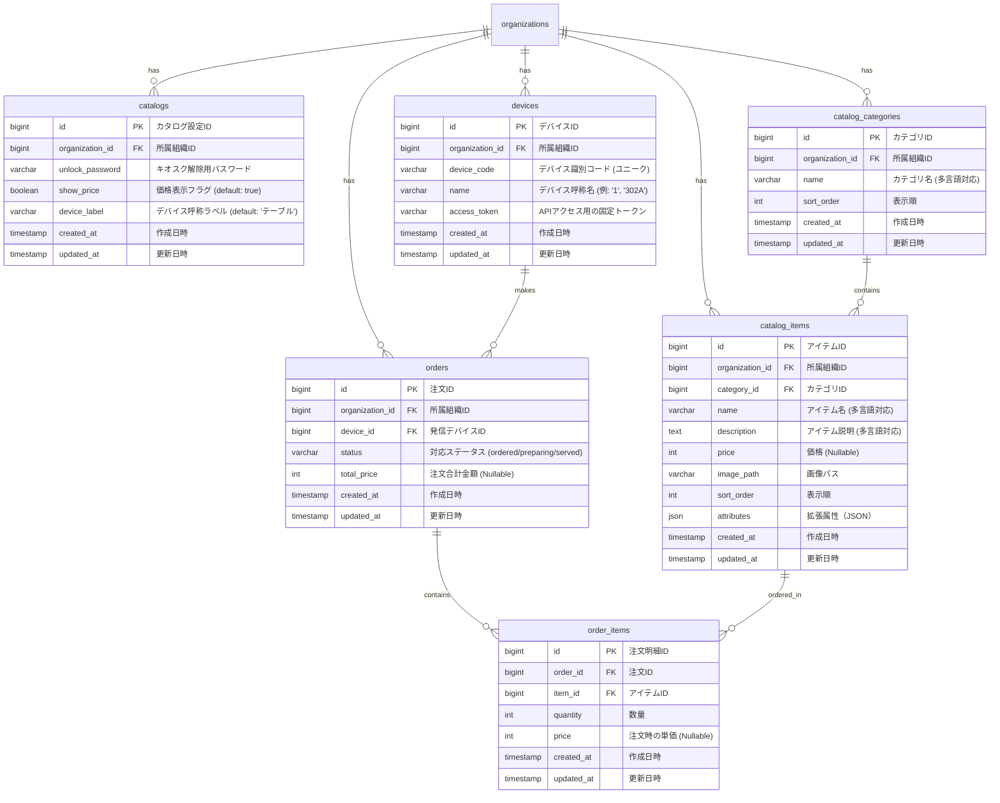

# カタログ・注文機能 データベース設計書

本書は、ミニマリスト業務統合サービス「Worknity」におけるカタログ・注文機能に関連するテーブルの物理構造、リレーションシップ、インデックス設計、およびデータ構造の定義について説明する。

---

## 1. データベース設計概要

カタログ・注文機能は、店舗や施設で表示するビジュアルメニューのカテゴリ、商品（アイテム）、注文元の端末（デバイス）、および送信された注文（リクエスト）情報を記録する。
あらゆる業態で共通して動作するよう、業態特化のカラムは極力排除し、設定によって挙動を変えるためのトグルスイッチ（価格非表示、デバイスの呼称）を定義している。

---

## 2. ER図（Entity Relationship Diagram）



---

## 3. テーブル詳細設計

### 3.1. `catalogs` テーブル（カタログ設定）
テナントごとのカタログ表示挙動（価格表示、解除パスワードなど）を設定する。

#### カラム定義
| No | 物理名 | 論理名 | 型 | 長さ | Null | Key | デフォルト | 説明 |
| :--- | :--- | :--- | :--- | :--- | :--- | :--- | :--- | :--- |
| 1 | `id` | カタログ設定ID | BIGINT | 20 | NO | PK | - | 自動採番 |
| 2 | `organization_id` | 所属組織ID | BIGINT | 20 | NO | FK | - | `organizations.id` への外部キー |
| 3 | `unlock_password` | キオスク解除パスワード | VARCHAR | 255 | NO | - | - | キオスクモードから通常画面に戻る際のパスワード（ハッシュ化） |
| 4 | `show_price` | 価格表示フラグ | BOOLEAN | - | NO | - | 1 | `true`: 価格と合計を表示、`false`: 価格を非表示にし合計計算も行わない |
| 5 | `device_label` | デバイス呼称ラベル | VARCHAR | 50 | NO | - | 'テーブル' | 注文端末の呼び名（`テーブル`、`セット面`、`部屋`、`ベッド`等） |
| 6 | `created_at` | 作成日時 | TIMESTAMP | - | YES | - | NULL | レコード作成日時 |
| 7 | `updated_at` | 更新日時 | TIMESTAMP | - | YES | - | NULL | レコード更新日時 |

---

### 3.2. `catalog_items` テーブル（カタログ掲載アイテム）
メニューやコール内容を登録する。

#### カラム定義
| No | 物理名 | 論理名 | 型 | 長さ | Null | Key | デフォルト | 説明 |
| :--- | :--- | :--- | :--- | :--- | :--- | :--- | :--- | :--- |
| 1 | `id` | アイテムID | BIGINT | 20 | NO | PK | - | 自動採番 |
| 2 | `organization_id` | 所属組織ID | BIGINT | 20 | NO | FK | - | `organizations.id` への外部キー |
| 3 | `category_id` | カテゴリID | BIGINT | 20 | NO | FK | - | `catalog_categories.id` への外部キー |
| 4 | `name` | アイテム名 | VARCHAR | 255 | NO | - | - | 多言語キーまたはJSON形式で翻訳データを保持 |
| 5 | `description` | アイテム説明 | TEXT | - | YES | - | NULL | アイテムの詳細説明（多言語対応） |
| 6 | `price` | 価格 | INT | 11 | YES | - | NULL | アイテムの価格。無料アメニティやコール要請などの場合は NULL |
| 7 | `image_path` | 画像パス | VARCHAR | 255 | YES | - | NULL | カタログ表示用の商品写真・イラストのURL |
| 8 | `sort_order` | 表示順 | INT | 11 | NO | - | 0 | カタログ画面での表示順番（昇順） |
| 9 | `attributes` | 拡張属性 | JSON | - | YES | - | NULL | トッピングオプションや追加タグなどの拡張枠 |
| 10 | `created_at` | 作成日時 | TIMESTAMP | - | YES | - | NULL | レコード作成日時 |
| 11 | `updated_at` | 更新日時 | TIMESTAMP | - | YES | - | NULL | レコード更新日時 |

* **インデックス設計（マルチテナントデータガード）：**
  * `idx_catalog_items_org_category` : `(organization_id, category_id, sort_order)` (テナントごとの特定カテゴリ商品の高速表示)

---

### 3.3. `devices` テーブル（注文用端末マスタ）
客席や個室に設置される物理端末（タブレット等）と、システム上の識別子を紐付ける。

#### カラム定義
| No | 物理名 | 論理名 | 型 | 長さ | Null | Key | デフォルト | 説明 |
| :--- | :--- | :--- | :--- | :--- | :--- | :--- | :--- | :--- |
| 1 | `id` | デバイスID | BIGINT | 20 | NO | PK | - | 自動採番 |
| 2 | `organization_id` | 所属組織ID | BIGINT | 20 | NO | FK | - | `organizations.id` への外部キー |
| 3 | `device_code` | デバイス識別コード | VARCHAR | 100 | NO | UNIQUE | - | 端末識別トークン。UUID等（API認証時に使用） |
| 4 | `name` | デバイス呼称番号 | VARCHAR | 50 | NO | - | - | 呼称用（例: `1` 番テーブル、`302-A` 号室などの呼称部分） |
| 5 | `access_token` | 固定アクセストークン | VARCHAR | 255 | NO | - | - | キオスク端末がJWTログインを毎回挟まずに通信するためのトークン |
| 6 | `created_at` | 作成日時 | TIMESTAMP | - | YES | - | NULL | レコード作成日時 |
| 7 | `updated_at` | 更新日時 | TIMESTAMP | - | YES | - | NULL | レコード更新日時 |

---

### 3.4. `orders` テーブル（注文・リクエスト親情報）
送信された注文やコールのステータスを管理する。

#### カラム定義
| No | 物理名 | 論理名 | 型 | 長さ | Null | Key | デフォルト | 説明 |
| :--- | :--- | :--- | :--- | :--- | :--- | :--- | :--- | :--- |
| 1 | `id` | 注文ID | BIGINT | 20 | NO | PK | - | 自動採番 |
| 2 | `organization_id` | 所属組織ID | BIGINT | 20 | NO | FK | - | `organizations.id` への外部キー |
| 3 | `device_id` | デバイスID | BIGINT | 20 | NO | FK | - | `devices.id` への外部キー。発信元の端末を示す |
| 4 | `status` | 対応ステータス | VARCHAR | 50 | NO | - | 'ordered' | `ordered` (未対応), `preparing` (対応中), `served` (完了) |
| 5 | `total_price` | 注文合計金額 | INT | 11 | YES | - | NULL | 注文時の合計金額。価格非表示時は NULL |
| 6 | `created_at` | 作成日時 | TIMESTAMP | - | YES | - | NULL | リクエスト送信日時 |
| 7 | `updated_at` | 更新日時 | TIMESTAMP | - | YES | - | NULL | 更新日時（ステータス変更日時） |

* **インデックス設計：**
  * `idx_orders_org_status` : `(organization_id, status, created_at)` (スタッフ管理ボードで「未完了の注文」を高速に抽出するためのインデックス)

---

## 4. 拡張属性（`attributes` JSON型）の構造例

`catalog_items.attributes` は、基本物理スキーマを崩すことなく、必要に応じて追加データを保存するために使用される。

### 4.1. 飲食店用（トッピング・セット選択項目など）
```json
{
  "options": [
    {
      "group_name": "トッピング",
      "multi_select": true,
      "choices": [
        {"name": "チャーシュー", "price": 200},
        {"name": "味付け玉子", "price": 100}
      ]
    },
    {
      "group_name": "量",
      "multi_select": false,
      "choices": [
        {"name": "大盛り", "price": 120},
        {"name": "並", "price": 0}
      ]
    }
  ]
}
```

### 4.2. 福祉施設・コール用（優先度タグなど）
価格を表示しないコールの優先度やアイコン表示設定などを定義。
```json
{
  "priority": "high",
  "icon_type": "water_drop",
  "requires_assistance": true
}
```
