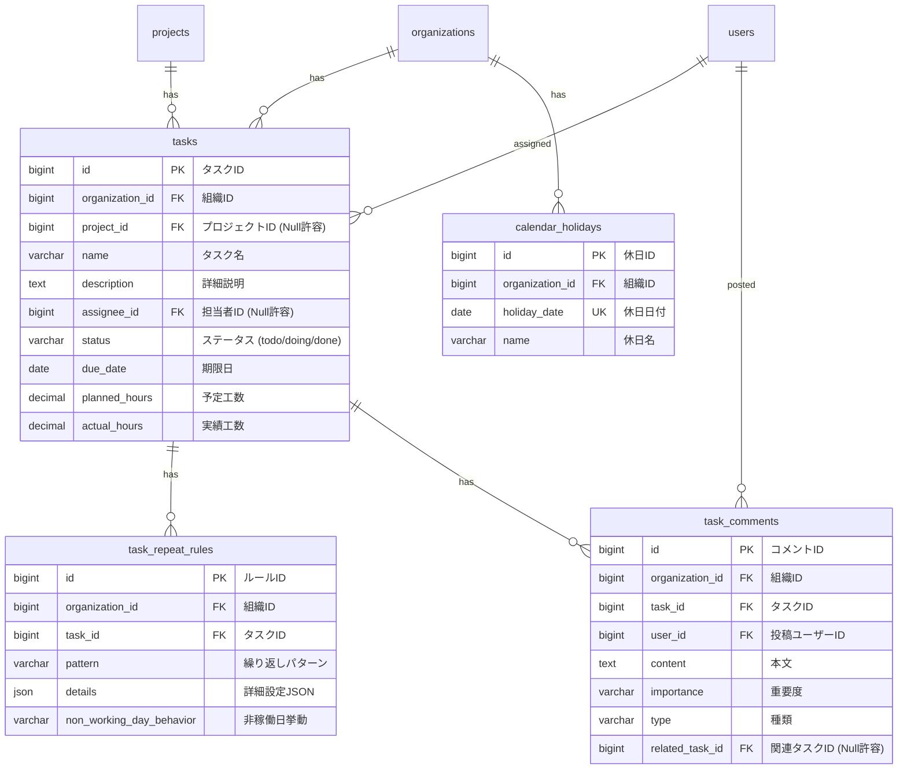

# タスク管理 データベース設計書

本書は、ミニマリスト業務統合サービス「Worknity」におけるタスク管理、繰り返し設定、およびコメント管理機能に関連するテーブルの物理構造、リレーションシップ、およびインデックス設計を定義するものである。

---

## 1. データベース設計方針

マルチテナント（データガード）の最優先事項に基づき、`tasks` や `task_comments` を含むすべてのテナント依存テーブルには `organization_id` を先頭に配置したインデックス（または複合インデックス）を設定し、データアクセス時の隔離を物理レベルで保証する。

---

## 2. ER図（Entity Relationship Diagram）

---

## 3. テーブル詳細設計

### 3.1. `tasks` テーブル（タスク）
日常業務やプロジェクトに関連する個々のタスクを管理する。

#### カラム定義
| No | 物理名 | 論理名 | 型 | 長さ | Null | Key | デフォルト | 説明 |
| :--- | :--- | :--- | :--- | :--- | :--- | :--- | :--- | :--- |
| 1 | `id` | タスクID | BIGINT | 20 | NO | PK | - | 自動採番 (Unsigned) |
| 2 | `organization_id` | 組織ID | BIGINT | 20 | NO | FK | - | `organizations.id` への外部キー (Unsigned) |
| 3 | `project_id` | プロジェクトID | BIGINT | 20 | YES | FK | NULL | `projects.id` への外部キー (Unsigned, Nullable) |
| 4 | `name` | タスク名 | VARCHAR | 100 | NO | - | - | タスクのタイトル |
| 5 | `description` | 詳細説明 | TEXT | - | YES | - | NULL | 作業手順や詳細な指示メモ |
| 6 | `assignee_id` | 担当者ユーザーID | BIGINT | 20 | YES | FK | NULL | `users.id` への外部キー (Unsigned, Nullable) |
| 7 | `status` | ステータス | VARCHAR | 50 | NO | - | `'todo'` | `todo` (未着手), `doing` (進行中), `done` (完了) |
| 8 | `due_date` | 期限日 | DATE | - | YES | - | NULL | タスクの完了期限日 |
| 9 | `planned_hours` | 予定工数 | DECIMAL | 5,1 | YES | - | NULL | 予定作業工数（時間） |
| 10 | `actual_hours` | 実績工数 | DECIMAL | 5,1 | YES | - | NULL | 実績作業工数（時間） |
| 11 | `created_at` | 作成日時 | TIMESTAMP | - | YES | - | NULL | レコード作成日時 |
| 12 | `updated_at` | 更新日時 | TIMESTAMP | - | YES | - | NULL | レコード更新日時 |

#### インデックス・外部キー制約
* **外部キー制約：**
  - `fk_tasks_organization_id` : `organization_id` -> `organizations(id)` (ON DELETE CASCADE)
  - `fk_tasks_project_id` : `project_id` -> `projects(id)` (ON DELETE SET NULL)
  - `fk_tasks_assignee_id` : `assignee_id` -> `users(id)` (ON DELETE SET NULL)
* **インデックス：**
  - `idx_tasks_organization_id` : `organization_id`
  - `idx_tasks_org_project` : `(organization_id, project_id)` (プロジェクト別タスク取得の高速化用)
  - `idx_tasks_org_status` : `(organization_id, status)` (かんばん・未完了タスク抽出用)
  - `idx_tasks_org_due_date` : `(organization_id, due_date)` (期限切れタスク抽出・カレンダー描画用)

---

### 3.2. `task_repeat_rules` テーブル（繰り返し設定）
タスクの自動生成および仮想マッピングのためのルールを定義する。

#### カラム定義
| No | 物理名 | 論理名 | 型 | 長さ | Null | Key | デフォルト | 説明 |
| :--- | :--- | :--- | :--- | :--- | :--- | :--- | :--- | :--- |
| 1 | `id` | ルールID | BIGINT | 20 | NO | PK | - | 自動採番 (Unsigned) |
| 2 | `organization_id` | 組織ID | BIGINT | 20 | NO | FK | - | `organizations.id` への外部キー (Unsigned) |
| 3 | `task_id` | タスクID | BIGINT | 20 | NO | FK | - | `tasks.id` への外部キー (Unsigned) |
| 4 | `pattern` | パターン | VARCHAR | 50 | NO | - | - | `daily`, `weekly`, `biweekly`, `monthly`, `first_day_of_month`, `last_day_of_month` |
| 5 | `details` | 詳細設定JSON | JSON | - | YES | - | NULL | 曜日指定(`"days_of_week": [1, 3]`)や日付指定などを格納 |
| 6 | `non_working_day_behavior` | 非稼働日挙動 | VARCHAR | 50 | NO | - | `'as_is'` | `as_is` (そのまま), `next_working_day` (翌稼働日), `prev_working_day` (前稼働日), `skip` (スキップ) |
| 7 | `created_at` | 作成日時 | TIMESTAMP | - | YES | - | NULL | レコード作成日時 |
| 8 | `updated_at` | 更新日時 | TIMESTAMP | - | YES | - | NULL | レコード更新日時 |

#### インデックス・外部キー制約
* **外部キー制約：**
  - `fk_repeat_rules_organization_id` : `organization_id` -> `organizations(id)` (ON DELETE CASCADE)
  - `fk_repeat_rules_task_id` : `task_id` -> `tasks(id)` (ON DELETE CASCADE)
* **インデックス：**
  - `idx_repeat_rules_organization_id` : `organization_id`
  - `uk_repeat_rules_task` : `(organization_id, task_id)` (1タスクに1ルールの一意制約)

---

### 3.3. `task_comments` テーブル（タスクコメント・申し送り）
タスクに対するコメントや作業申し送りを管理する。属性値によるフィルタリングに対応。

#### カラム定義
| No | 物理名 | 論理名 | 型 | 長さ | Null | Key | デフォルト | 説明 |
| :--- | :--- | :--- | :--- | :--- | :--- | :--- | :--- | :--- |
| 1 | `id` | コメントID | BIGINT | 20 | NO | PK | - | 自動採番 (Unsigned) |
| 2 | `organization_id` | 組織ID | BIGINT | 20 | NO | FK | - | `organizations.id` への外部キー (Unsigned) |
| 3 | `task_id` | タスクID | BIGINT | 20 | NO | FK | - | `tasks.id` への外部キー (Unsigned) |
| 4 | `user_id` | 投稿ユーザーID | BIGINT | 20 | NO | FK | - | `users.id` への外部キー (Unsigned) |
| 5 | `content` | 本文 | TEXT | - | NO | - | - | コメント内容 |
| 6 | `importance` | 重要度 | VARCHAR | 20 | NO | - | `'medium'` | `high` (高), `medium` (中), `low` (低) |
| 7 | `type` | 種類 | VARCHAR | 50 | NO | - | `'communication'` | `communication` (連絡), `handover` (申し送り), `log` (作業ログ), `memo` (メモ) |
| 8 | `related_task_id` | 関連タスクID | BIGINT | 20 | YES | FK | NULL | `tasks.id` への自己参照外部キー (Unsigned, Nullable) |
| 9 | `created_at` | 作成日時 | TIMESTAMP | - | YES | - | NULL | レコード作成日時（一括削除条件の判定に使用） |
| 10 | `updated_at` | 更新日時 | TIMESTAMP | - | YES | - | NULL | レコード更新日時 |

#### インデックス・外部キー制約
* **外部キー制約：**
  - `fk_comments_organization_id` : `organization_id` -> `organizations(id)` (ON DELETE CASCADE)
  - `fk_comments_task_id` : `task_id` -> `tasks(id)` (ON DELETE CASCADE)
  - `fk_comments_user_id` : `user_id` -> `users(id)` (ON DELETE CASCADE)
  - `fk_comments_related_task_id` : `related_task_id` -> `tasks(id)` (ON DELETE SET NULL)
* **インデックス：**
  - `idx_comments_organization_id` : `organization_id`
  - `idx_comments_org_task` : `(organization_id, task_id, created_at)` (タスク別コメントの時系列取得用)
  - `idx_comments_cleanup` : `(organization_id, type, importance, created_at)` (一括クリーンアップ削除処理の高速化用)

---

### 3.4. `calendar_holidays` テーブル（組織カレンダー休日）
組織（テナント）ごとの休日設定を管理する。

#### カラム定義
| No | 物理名 | 論理名 | 型 | 長さ | Null | Key | デフォルト | 説明 |
| :--- | :--- | :--- | :--- | :--- | :--- | :--- | :--- | :--- |
| 1 | `id` | 休日ID | BIGINT | 20 | NO | PK | - | 自動採番 (Unsigned) |
| 2 | `organization_id` | 組織ID | BIGINT | 20 | NO | FK | - | `organizations.id` への外部キー (Unsigned) |
| 3 | `holiday_date` | 休日日付 | DATE | - | NO | UK | - | 休日指定日 (Y-m-d) |
| 4 | `name` | 休日名 | VARCHAR | 100 | NO | - | - | 例:「夏季休暇」「創立記念日」「お盆休み」 |
| 5 | `created_at` | 作成日時 | TIMESTAMP | - | YES | - | NULL | レコード作成日時 |
| 6 | `updated_at` | 更新日時 | TIMESTAMP | - | YES | - | NULL | レコード更新日時 |

#### インデックス・外部キー制約
* **外部キー制約：**
  - `fk_holidays_organization_id` : `organization_id` -> `organizations(id)` (ON DELETE CASCADE)
* **一意制約（Unique Key）：**
  - `uk_holidays_org_date` : `(organization_id, holiday_date)` (同一日に複数の休日重複登録防止)
* **インデックス：**
  - `idx_holidays_organization_id` : `organization_id`

---

## 4. 既存テーブルへの変更設計

### 4.1. `organizations` テーブル（組織マスタ）
組織ごとの稼働曜日設定を追加するため、以下のカラムを追加する。

#### 追加カラム
| 物理名 | 論理名 | 型 | 長さ | Null | デフォルト | 説明 |
| :--- | :--- | :--- | :--- | :--- | :--- | :--- |
| `working_days` | 稼働曜日 | VARCHAR | 50 | NO | `'1,2,3,4,5'` | カンマ区切りの曜日インデックス。`1` (月) 〜 `7` (日)。初期値は月〜金稼働。 |
