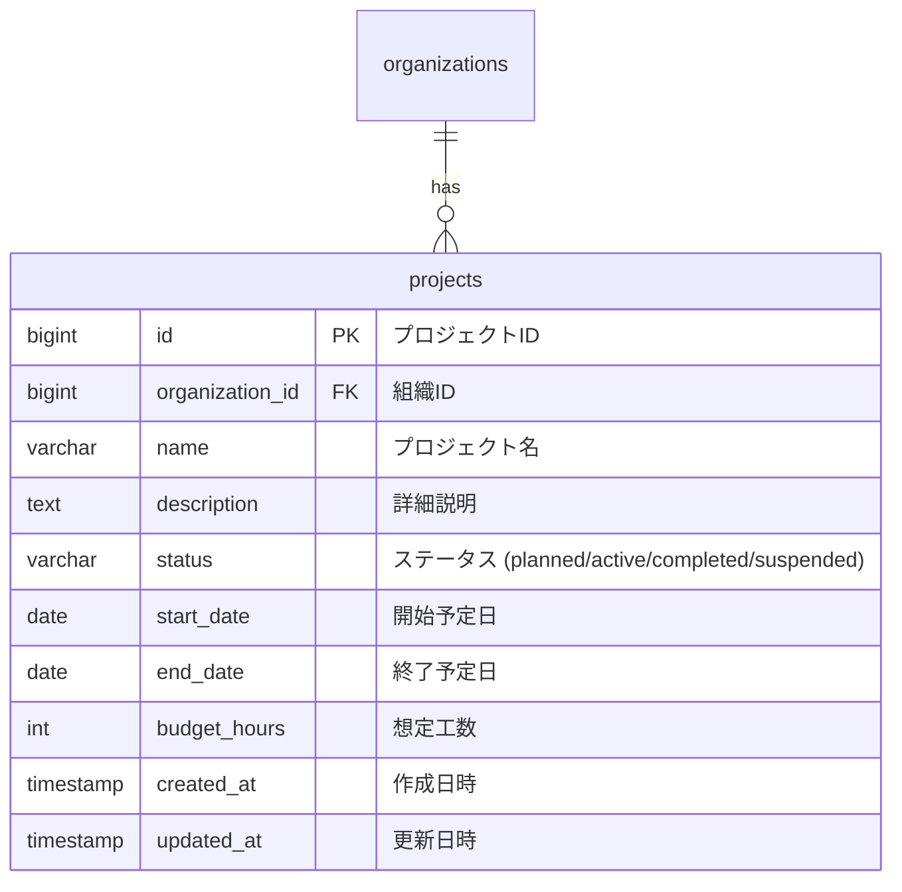

# プロジェクト管理 データベース設計書

本書は、ミニマリスト業務統合サービス「Worknity」におけるプロジェクト管理機能に関連するテーブルの物理構造、リレーションシップ、およびインデックス設計を定義するものである。

---

## 1. データベース設計方針

マルチテナント（データガード）設計に基づき、すべてのプロジェクトデータは組織ID（`organization_id`）に紐付けて厳密に管理される。
また、テナント間でのクエリ漏れ防止およびパフォーマンス向上のため、`organization_id` を先頭に配置した複合インデックスを設定する。

---

## 2. ER図（Entity Relationship Diagram）

---

## 3. テーブル詳細設計

### 3.1. `projects` テーブル（プロジェクトマスタ）

現場、案件、または任意のプロジェクト単位の情報を管理する。

#### カラム定義
| No | 物理名 | 論理名 | 型 | 長さ | Null | Key | デフォルト | 説明 |
| :--- | :--- | :--- | :--- | :--- | :--- | :--- | :--- | :--- |
| 1 | `id` | プロジェクトID | BIGINT | 20 | NO | PK | - | 自動採番 (Auto Increment, Unsigned) |
| 2 | `organization_id` | 組織ID | BIGINT | 20 | NO | FK | - | `organizations.id` への外部キー (Unsigned) |
| 3 | `name` | プロジェクト名 | VARCHAR | 100 | NO | - | - | 現場名、案件名など |
| 4 | `description` | 詳細説明 | TEXT | - | YES | - | NULL | プロジェクトの概要や補足情報 |
| 5 | `status` | ステータス | VARCHAR | 50 | NO | - | `'planned'` | `planned` (未着手), `active` (進行中), `completed` (完了), `suspended` (保留/中断) |
| 6 | `start_date` | 開始予定日 | DATE | - | YES | - | NULL | プロジェクトの開始予定日 (Y-m-d) |
| 7 | `end_date` | 終了予定日 | DATE | - | YES | - | NULL | プロジェクトの終了予定日 (Y-m-d) |
| 8 | `budget_hours` | 想定工数 | INT | 11 | YES | - | NULL | プロジェクト完了に必要な総想定工数（時間） |
| 9 | `created_at` | 作成日時 | TIMESTAMP | - | YES | - | NULL | レコード作成日時 |
| 10 | `updated_at` | 更新日時 | TIMESTAMP | - | YES | - | NULL | レコード更新日時 |

#### インデックス・外部キー制約
* **外部キー制約：**
  - `fk_projects_organization_id` : `organization_id` -> `organizations(id)` (ON DELETE CASCADE / ON UPDATE CASCADE)
* **インデックス：**
  - `idx_projects_organization_id` : `organization_id` (テナント検索の高速化用)
  - `idx_projects_org_status` : `(organization_id, status)` (テナントごとのステータス絞り込み・進捗一覧の高速化用)
  - `idx_projects_org_end_date` : `(organization_id, end_date)` (期日が近い順のプロジェクト検索の高速化用)
