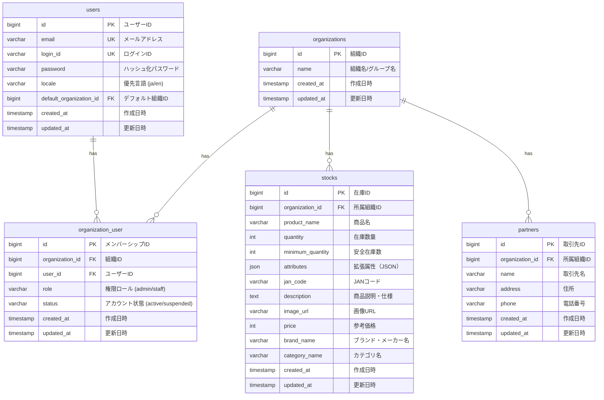

# マスタ管理 データベース設計書

本書は、ミニマリスト業務統合サービス「Worknity」におけるマスタデータ管理に関連するテーブルの物理構造、リレーションシップ、およびインデックス設計を定義するものである。

---

## 1. マスタ管理データベース概要

本システムにおける基盤マスタデータ（組織、ユーザー、所属関係、在庫商品、および取引先）を管理するテーブル群である。  
すべてのマスタデータは、マルチテナント隔離（データガード）に基づき、組織ID（`organization_id`）に紐付けて厳密に管理される。

---

## 2. ER図（Entity Relationship Diagram）

マスタ管理に関連するテーブルの関連性は以下の通りである。

---

## 3. テーブル詳細設計

### 3.1. `organizations` テーブル（組織マスタ）
システムを利用する企業、チーム、団体、個人事業主（テナント）を管理する。

#### カラム定義
| No | 物理名 | 論理名 | 型 | 長さ | Null | Key | デフォルト | 説明 |
| :--- | :--- | :--- | :--- | :--- | :--- | :--- | :--- | :--- |
| 1 | `id` | 組織ID | BIGINT | 20 | NO | PK | - | 自動採番 (Auto Increment, Unsigned) |
| 2 | `name` | 組織名/グループ名 | VARCHAR | 255 | NO | - | - | 企業名、チーム名、または事業主の屋号 |
| 3 | `created_at` | 作成日時 | TIMESTAMP | - | YES | - | NULL | レコード作成日時 |
| 4 | `updated_at` | 更新日時 | TIMESTAMP | - | YES | - | NULL | レコード更新日時 |

---

### 3.2. `users` テーブル（ユーザーマスタ）
システムにログイン可能なアカウント情報を管理する。

#### カラム定義
| No | 物理名 | 論理名 | 型 | 長さ | Null | Key | デフォルト | 説明 |
| :--- | :--- | :--- | :--- | :--- | :--- | :--- | :--- | :--- |
| 1 | `id` | ユーザーID | BIGINT | 20 | NO | PK | - | 自動採番 (Auto Increment, Unsigned) |
| 2 | `email` | メールアドレス | VARCHAR | 255 | YES | UK | NULL | ログインIDとして使用 (一意制約。Nullable) |
| 3 | `login_id` | ログインID | VARCHAR | 255 | YES | UK | NULL | ログイン用文字列ID (一意制約。Nullable) |
| 4 | `password` | パスワード | VARCHAR | 255 | NO | - | - | ハッシュ化されたパスワード文字列 |
| 5 | `locale` | 優先言語 | VARCHAR | 10 | NO | - | `'ja'` | 優先表示言語設定。`ja`（日本語）または `en`（英語） |
| 6 | `default_organization_id` | デフォルト組織ID | BIGINT | 20 | YES | FK | NULL | ログイン時に自動選択される優先組織ID (Unsigned) |
| 7 | `created_at` | 作成日時 | TIMESTAMP | - | YES | - | NULL | レコード作成日時 |
| 8 | `updated_at` | 更新日時 | TIMESTAMP | - | YES | - | NULL | レコード更新日時 |

#### インデックス・外部キー制約
* **外部キー制約：**
  * `fk_users_default_organization_id` : `default_organization_id` -> `organizations(id)` (ON DELETE SET NULL)
* **一意制約（Unique Key）：**
  * `uk_users_email` : `email`
  * `uk_users_login_id` : `login_id`

---

### 3.3. `organization_user` テーブル（組織メンバーシップ）
ユーザーがどの組織にどの権限（ロール）および状態で所属しているかを管理する。

#### カラム定義
| No | 物理名 | 論理名 | 型 | 長さ | Null | Key | デフォルト | 説明 |
| :--- | :--- | :--- | :--- | :--- | :--- | :--- | :--- | :--- |
| 1 | `id` | メンバーシップID | BIGINT | 20 | NO | PK | - | 自動採番 (Auto Increment, Unsigned) |
| 2 | `organization_id` | 組織ID | BIGINT | 20 | NO | FK | - | `organizations.id` への外部キー (Unsigned) |
| 3 | `user_id` | ユーザーID | BIGINT | 20 | NO | FK | - | `users.id` への外部キー (Unsigned) |
| 4 | `role` | 権限ロール | VARCHAR | 50 | NO | - | - | `admin` (管理者) または `staff` (スタッフ) |
| 5 | `status` | アカウント状態 | VARCHAR | 50 | NO | - | `'active'` | `active` (有効) または `suspended` (一時停止) |
| 6 | `created_at` | 作成日時 | TIMESTAMP | - | YES | - | NULL | レコード作成日時 |
| 7 | `updated_at` | 更新日時 | TIMESTAMP | - | YES | - | NULL | レコード更新日時 |

#### インデックス・外部キー制約
* **外部キー制約：**
  * `fk_org_user_organization_id` : `organization_id` -> `organizations(id)` (ON DELETE CASCADE)
  * `fk_org_user_user_id` : `user_id` -> `users(id)` (ON DELETE CASCADE)
* **一意制約（Unique Key）：**
  * `uk_org_user_org_user` : `(organization_id, user_id)` (重複登録防止)
* **インデックス：**
  * `idx_org_user_user_id` : `user_id`

---

### 3.4. `stocks` テーブル（在庫マスタ）
組織が管理する在庫アイテムの情報を管理する。

#### カラム定義
| No | 物理名 | 論理名 | 型 | 長さ | Null | Key | デフォルト | 説明 |
| :--- | :--- | :--- | :--- | :--- | :--- | :--- | :--- | :--- |
| 1 | `id` | 在庫ID | BIGINT | 20 | NO | PK | - | 自動採番 (Auto Increment, Unsigned) |
| 2 | `organization_id` | 所属組織ID | BIGINT | 20 | NO | FK | - | `organizations.id` への外部キー (Unsigned) |
| 3 | `product_name` | 商品名 | VARCHAR | 255 | NO | - | - | 管理対象の商品名 |
| 4 | `quantity` | 在庫数量 | INT | 11 | NO | - | 0 | 現在の在庫数 |
| 5 | `minimum_quantity` | 安全在庫数 | INT | 11 | NO | - | 0 | 警告しきい値 |
| 6 | `attributes` | 拡張属性 | JSON | - | YES | - | NULL | 賞味期限、ロケーション等のための拡張領域 |
| 7 | `jan_code` | JANコード | VARCHAR | 255 | YES | - | NULL | バーコードスキャン照合用のJAN/EANコード |
| 8 | `description` | 商品説明・仕様 | TEXT | - | YES | - | NULL | 商品の詳しい説明・詳細仕様 |
| 9 | `image_url` | 商品画像URL | VARCHAR | 2048 | YES | - | NULL | 商品画像URL |
| 10 | `price` | 参考価格 | INT | 11 | YES | - | NULL | 参考販売価格または仕入れ価格 |
| 11 | `brand_name` | ブランド・メーカー名 | VARCHAR | 255 | YES | - | NULL | ブランド名・メーカー名 |
| 12 | `category_name` | カテゴリ名 | VARCHAR | 255 | YES | - | NULL | 商品の所属ジャンル・カテゴリ名 |
| 13 | `created_at` | 作成日時 | TIMESTAMP | - | YES | - | NULL | レコード作成日時 |
| 14 | `updated_at` | 更新日時 | TIMESTAMP | - | YES | - | NULL | レコード更新日時 |

#### インデックス・外部キー制約
* **外部キー制約：**
  * `fk_stocks_organization_id` : `organization_id` -> `organizations(id)` (ON DELETE RESTRICT)
* **インデックス：**
  * `idx_stocks_organization_id` : `organization_id`
  * `idx_stocks_organization_product` : `(organization_id, product_name)`
  * `idx_stocks_org_jan` : `(organization_id, jan_code)`

---

### 3.5. `partners` テーブル（取引先マスタ - 新規設計）
出庫伝票の印刷（宛先・住所・連絡先の記載）およびオートコンプリートを見据えた、取引先情報を管理するマスタテーブル。

#### カラム定義
| No | 物理名 | 論理名 | 型 | 長さ | Null | Key | デフォルト | 説明 |
| :--- | :--- | :--- | :--- | :--- | :--- | :--- | :--- | :--- |
| 1 | `id` | 取引先ID | BIGINT | 20 | NO | PK | - | 自動採番 (Auto Increment, Unsigned) |
| 2 | `organization_id` | 所属組織ID | BIGINT | 20 | NO | FK | - | `organizations.id` への外部キー (Unsigned) |
| 3 | `name` | 取引先名 | VARCHAR | 255 | NO | - | - | 取引先の名称（必須） |
| 4 | `address` | 住所 | VARCHAR | 255 | YES | - | NULL | 取引先の住所（出庫伝票の印刷用） |
| 5 | `phone` | 電話番号 | VARCHAR | 50 | YES | - | NULL | 取引先の電話番号（出庫伝票の印刷用） |
| 6 | `created_at` | 作成日時 | TIMESTAMP | - | YES | - | NULL | レコード作成日時 |
| 7 | `updated_at` | 更新日時 | TIMESTAMP | - | YES | - | NULL | レコード更新日時 |

#### インデックス・外部キー制約
* **外部キー制約：**
  * `fk_partners_organization_id` : `organization_id` -> `organizations(id)` (ON DELETE CASCADE)
* **インデックス：**
  * `idx_partners_org_name` : `(organization_id, name)` (テナント内での取引先名オートコンプリート/検索の高速化用複合インデックス)
