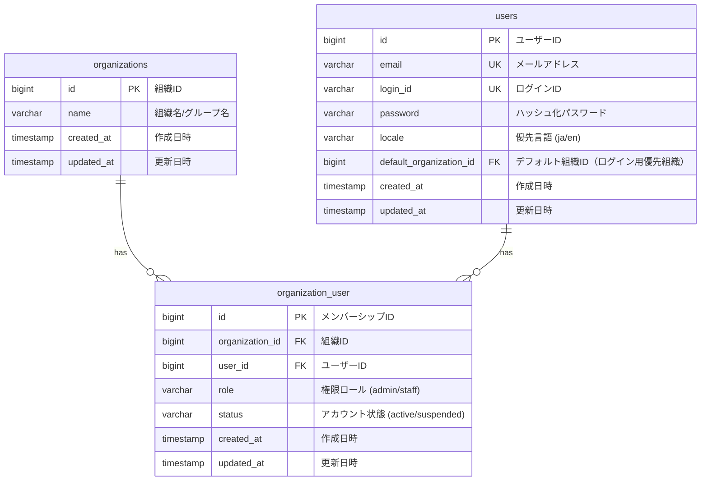

# ユーザー管理 データベース設計書

本書は、ミニマリスト業務統合サービス「Worknity」におけるユーザー管理に関連するテーブルの物理構造、リレーションシップ、インデックス設計、およびスキーマ変更（マイグレーション）内容を定義するものである。

---

## 1. ユーザー管理データベース概要

本システムはマルチテナント（複数組織）構成であり、以下の設計方針に基づいてデータを管理する。

1. **マルチ組織メンバーシップの許容（1ユーザー対多組織）：**
   - ユーザー（`users`）と組織（`organizations`）は、中間テーブルである `organization_user` を通じて多対多（N:M）の関係を持つ。
   - これにより、1つのログインアカウント（メールアドレス）で複数の組織に所属し、組織ごとに異なる権限ロールや状態（有効/無効）を持つことができる。
2. **組織単位でのアカウント無効化：**
   - `organization_user` テーブルに `status` カラムを追加し、組織単位で「このスタッフはこの組織では一時停止中」という状態を保持できるようにする。
3. **データガードのためのインデックス：**
   - `organization_user` のクエリを高速化するため、複合インデックス `(organization_id, user_id)` および `(user_id, organization_id)` を定義する。
4. **多言語優先設定の保存（ユーザーマスタ）：**
   - ユーザーマスタ（`users`）に `locale` カラムを追加し、各ユーザーの優先表示言語設定（`ja` / `en`）を永続化する。

---

## 2. ER図（Entity Relationship Diagram）

ユーザー管理に関連するテーブルの関連性は以下の通りである。



---

## 3. テーブル詳細設計（追加・変更箇所）

### 3.1. `organization_user` テーブル（組織メンバーシップ）
スタッフ管理における最も重要な制御テーブルであり、`status` カラムを追加する。

#### カラム定義
| No | 物理名 | 論理名 | 型 | 長さ | Null | Key | デフォルト | 説明 |
| :--- | :--- | :--- | :--- | :--- | :--- | :--- | :--- | :--- |
| 1 | `id` | メンバーシップID | BIGINT | 20 | NO | PK | - | 自動採番 (Auto Increment, Unsigned) |
| 2 | `organization_id` | 組織ID | BIGINT | 20 | NO | FK | - | `organizations.id` への外部キー (Unsigned) |
| 3 | `user_id` | ユーザーID | BIGINT | 20 | NO | FK | - | `users.id` への外部キー (Unsigned) |
| 4 | `role` | 権限ロール | VARCHAR | 50 | NO | - | - | `admin` (管理者), `staff` (スタッフ), `guest` (ゲスト) |
| 5 | **`status`** | アカウント状態 | VARCHAR | 50 | NO | - | `'active'` | `active` (有効) または `suspended` (一時停止) |
| 6 | `created_at` | 作成日時 | TIMESTAMP | - | YES | - | NULL | レコード作成日時 |
| 7 | `updated_at` | 更新日時 | TIMESTAMP | - | YES | - | NULL | レコード更新日時 |

#### インデックス・外部キー制約
* **外部キー制約：**
  * `fk_org_user_organization_id` : `organization_id` -> `organizations(id)` (ON DELETE CASCADE)
  * `fk_org_user_user_id` : `user_id` -> `users(id)` (ON DELETE CASCADE)
* **一意制約（Unique Key）：**
  * `uk_org_user_org_user` : `(organization_id, user_id)` (同一ユーザーの同一組織への多重登録防止)
* **インデックス：**
  * `idx_org_user_user_id` : `user_id` (ユーザーに紐づく所属組織一覧の高速検索用)

---

### 3.2. `users` テーブル（ユーザーマスタ - 優先言語カラムの追加）
多言語対応に伴い、優先表示言語を保持する `locale` カラムを `users` テーブルに追加する。

#### カラム定義（追加箇所のみ抜粋）
| No | 物理名 | 論理名 | 型 | 長さ | Null | Key | デフォルト | 説明 |
| :--- | :--- | :--- | :--- | :--- | :--- | :--- | :--- | :--- |
| 5 | **`locale`** | 優先言語 | VARCHAR | 10 | NO | - | `'ja'` | 優先表示言語設定。`ja`（日本語）または `en`（英語） |

---

## 4. データベース調整 DDL（マイグレーション定義）

すでにテーブルが存在する開発環境や本番環境において、アカウント状態を管理するための `status` カラムおよび優先言語を管理するための `locale` カラムを追加するためのDDL文。

```sql
-- 1. organization_user テーブルに status カラムを追加する
ALTER TABLE `organization_user`
ADD COLUMN `status` VARCHAR(50) NOT NULL DEFAULT 'active' COMMENT 'アカウント状態 (active/suspended)'
AFTER `role`;

-- 2. 状態による検索や絞り込みを高速化するための複合インデックス追加 (必要に応じて)
ALTER TABLE `organization_user`
ADD INDEX `idx_org_user_org_status` (`organization_id`, `status`);

-- 3. users テーブルに locale カラムを追加する
ALTER TABLE `users`
ADD COLUMN `locale` VARCHAR(10) NOT NULL DEFAULT 'ja' COMMENT '優先言語設定 (ja/en)'
AFTER `password`;
```

---

## 5. マルチテナント（データガード）とセキュアログインクエリ方針

バックエンドAPIにおけるテナント隔離（データガード）および認証チェック時のSQLクエリの考え方を以下に示す。

### 5.1. ログイン時の組織所属および有効状態の同時チェック
ログインを許可する際、ユーザーのパスワードハッシュを照合した上で、所属している組織へのアクセス可否および優先言語設定を以下の結合クエリで取得する。

```sql
SELECT 
    ou.organization_id, 
    ou.role, 
    ou.status,
    u.locale
FROM 
    `organization_user` ou
JOIN
    `users` u ON ou.user_id = u.id
WHERE 
    ou.user_id = :user_id 
    AND ou.organization_id = :organization_id;
```
* **認証制御ルール：**
  * 上記クエリの実行結果において、`status` が `'suspended'` の場合はログインおよびトークン更新を拒否し、画面側に `403 Forbidden` を返却する。
  * 認証成功時、バックエンドが発行するJWTトークンに `locale` を含めて返却し、フロントエンド側はこの値を用いて表示言語を自動初期化する。

### 5.2. 管理者による自組織ユーザー一覧取得
管理者が「ユーザー一覧」をリクエストした際、他組織のユーザーが混入しないよう、必ず以下の結合クエリを使用する。

```sql
SELECT 
    u.id AS user_id,
    u.email,
    ou.role,
    ou.status,
    ou.created_at AS joined_at
FROM 
    `organization_user` ou
JOIN 
    `users` u ON ou.user_id = u.id
WHERE 
    ou.organization_id = :admin_organization_id
ORDER BY 
    ou.created_at ASC;
```
* **データガード保証：**
  * パラメータ `:admin_organization_id` はリクエスト内の値ではなく、**JWTトークン（認証セッション）から直接復号・抽出した組織ID**を使用する。これにより、リクエストの偽装による情報漏洩を防ぐ。

---

## 6. ゲスト（外注先）向け拡張データベース構造指針

外注先パートナー（ゲスト）が「自社に関連付けられたデータのみ」を閲覧できるようにするための、将来的なデータベース拡張指針。

### 6.1. 取引先（ベンダー）との紐付け構造
ゲストアカウントが特定の外部ベンダーに所属していることを識別するため、以下のいずれかの方針でデータベースを拡張する。

* **方針A：中間テーブル `organization_user` へのカラム追加（推奨）**
  * 組織メンバーシップに `vendor_id`（外部キー、NULL許容）を追加する。
  * 一般スタッフや管理者の場合は `NULL`、ゲストの場合は該当する取引先レコードのID（`vendors.id`）を紐付ける。
* **方針B：拡張属性（`attributes` JSON型カラム）の活用**
  * `organization_user` または `users` テーブルの拡張属性 JSON 内に `{ "vendor_id": 101 }` などのキーを格納する。追加マイグレーションやカラム追加を伴わずに、柔軟に外部パートナーとの紐付けを実装できる。
