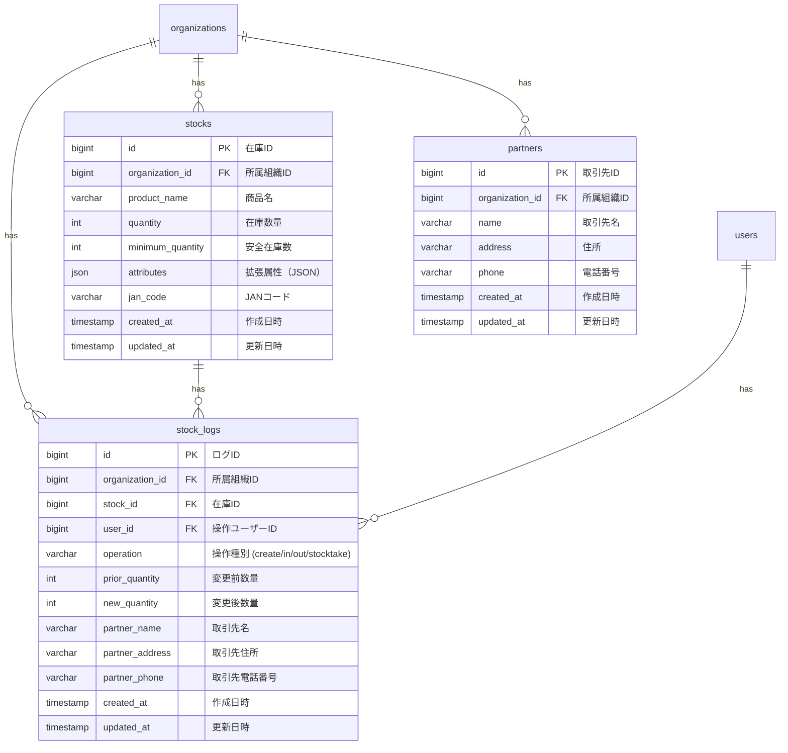

# 在庫管理 データベース設計書

本書は、ミニマリスト業務統合サービス「Worknity」における在庫管理機能に関連するテーブルの物理構造、リレーションシップ、インデックス設計、および拡張データ構造（JSON）の定義について説明する。

---

## 1. 在庫管理データベース概要

在庫管理機能は、自組織の保有する在庫商品の現在庫管理、日々の入出庫・棚卸操作、および変動履歴（ログ）の保存を担う。  
特に、同時書き込み時のデータ整合性を保証するための「悲観的ロック」や「トランザクション制御」、および取引時点の情報を不変データとして残す「伝票情報コピー」がデータガードの観点から重要となる。

---

## 2. ER図（Entity Relationship Diagram - 在庫管理周辺）

在庫管理および取引先に関連するテーブルの関連性は以下の通りである。



---

## 3. テーブル詳細設計

### 3.1. `stock_logs` テーブル（在庫変動履歴ログ）
在庫の変更履歴をすべて記録する。監査証跡として利用し、出庫伝票印刷時の取引先情報（取引時点のデータ）を保持する。

#### カラム定義
| No | 物理名 | 論理名 | 型 | 長さ | Null | Key | デフォルト | 説明 |
| :--- | :--- | :--- | :--- | :--- | :--- | :--- | :--- | :--- |
| 1 | `id` | ログID | BIGINT | 20 | NO | PK | - | 自動採番 (Auto Increment, Unsigned) |
| 2 | `organization_id` | 所属組織ID | BIGINT | 20 | NO | FK | - | `organizations.id` への外部キー (Unsigned) |
| 3 | `stock_id` | 在庫ID | BIGINT | 20 | NO | FK | - | `stocks.id` への外部キー (Unsigned) |
| 4 | `user_id` | 操作ユーザーID | BIGINT | 20 | YES | FK | NULL | `users.id` への外部キー (Unsigned)。退職等で削除された場合は NULL 許容。 |
| 5 | `operation` | 操作種別 | VARCHAR | 50 | NO | - | - | `create` (新規登録), `in` (入庫), `out` (出庫), `stocktake` (棚卸) |
| 6 | `prior_quantity` | 変更前数量 | INT | 11 | NO | - | 0 | 変更前の在庫数 |
| 7 | `new_quantity` | 変更後数量 | INT | 11 | NO | - | 0 | 変更後の在庫数（差分は `new_quantity - prior_quantity` で計算可能） |
| 8 | `partner_name` | 取引時の取引先名 | VARCHAR | 255 | YES | - | NULL | 伝票用取引先名（入力時のマスタ情報または手作業のテキストをコピー） |
| 9 | `partner_address` | 取引時の取引先住所 | VARCHAR | 255 | YES | - | NULL | 伝票用取引先住所（入力時のマスタ情報をコピー） |
| 10 | `partner_phone` | 取引時の取引先電話番号 | VARCHAR | 50 | YES | - | NULL | 伝票用取引先電話番号（入力時のマスタ情報をコピー） |
| 11 | `created_at` | 作成日時 | TIMESTAMP | - | YES | - | NULL | レコード作成日時（操作日時に相当） |
| 12 | `updated_at` | 更新日時 | TIMESTAMP | - | YES | - | NULL | レコード更新日時 |

#### インデックス・外部キー制約
* **外部キー制約：**
  * `fk_stock_logs_organization_id` : `organization_id` -> `organizations(id)` (ON DELETE RESTRICT / ON UPDATE CASCADE)
  * `fk_stock_logs_stock_id` : `stock_id` -> `stocks(id)` (ON DELETE CASCADE / ON UPDATE CASCADE)
  * `fk_stock_logs_user_id` : `user_id` -> `users(id)` (ON DELETE SET NULL / ON UPDATE CASCADE)
* **インデックス：**
  * `idx_stock_logs_organization_stock` : `(organization_id, stock_id, created_at)` (特定の商品の直近履歴を高速に取得するための複合インデックス)

---

## 4. JSON型（拡張属性 `attributes`）のデータ構造定義例

`stocks.attributes` は、将来的に追加される特化型オプション（食品倉庫、アパレルなど）のデータを保持するためのJSON型カラムである。フェーズ1では基本的に `NULL` または空のJSON `{}` を許容するが、将来の拡張を見据えたデータ構造の例を以下に示す。

### 4.1. 食品倉庫特化オプション時のデータ構造例
```json
{
  "expiration_date": "2026-06-30",
  "temperature_zone": "frozen",
  "lot_number": "LOT-20260530-01",
  "storage_location": "冷凍ラック A-3"
}
```

### 4.2. アパレル特化オプション時のデータ構造例
```json
{
  "size": "L",
  "color": "Navy",
  "material": "Cotton 100%"
}
```
