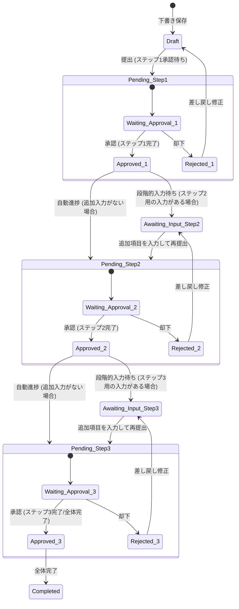

# 申請報告管理 機能仕様書

本ドキュメントは、ユーザーが独自のフォーマットを定義し、日常の記録（日報など）や決裁・精算（稟議、旅費など）をスマホから手軽に行うための「申請/報告」機能の仕様を定義します。
また、本機能はシステム全体の「共通ワークフローエンジン」としても機能し、発注管理や勤怠管理など、承認を必要とする他のモジュールとポリモーフィックに関連して動作します。

---

## 1. 機能の概要と目的

Worknityの「認知負荷ゼロ」のコンセプトに基づき、小規模事業者がマニュアルなしで「日報の提出」や「購入申請」「経費精算」を完結できるようにします。
また、業務プロセスに合わせて、最大3段階の承認ルートを設定でき、「承認されたら次の項目を入力する」といった段階的入力ワークフローを実現します。
さらに、他のモジュール（発注管理、勤怠管理など）から承認を依頼された際に、本機能が共通の承認エンジンとして動作することで、ユーザーが「承認画面」をあちこち往復する認知負荷を極小化します。

### コンセプト（認知負荷ゼロ）との整合
* **わかりやすさと視認性の向上（画面表示）**
  * 画面上は「申請」「報告」「承認」を正しく漢字表記とし、他のモジュール（勤怠・在庫など）とトーン＆マナーを統一します。
  * 複雑なワークフロー用語（トランジション、アサインなど）は排し、現在の状態（「承認待ち」「差し戻し」など）を明確表示します。
* **迷わせない入力欄**
  * テンプレートごとに必要な項目だけを画面に表示し、スマホのタッチ操作（選択肢や日付ピッカー、テンキー数値入力）を最優先にします。

---

## 2. ユースケースと業務フロー

### 2.1. 代表的なユースケース

1. **日々の報告（日報）**
   * テンプレート: `[報告] 本日の日報`
   * 入力項目: 今日の業務内容（テキスト）、所感（テキスト）、明日の予定（テキスト）
   * 承認ルート: 1段階（「課長」または「先生」など、設定したクラスの承認）
2. **高額商品の購入申請（稟議）**
   * テンプレート: `[申請] 購入申請`
   * 入力項目: 商品名（テキスト）、金額（数値）、購入理由（テキスト）
   * 承認ルート: 2段階（課長承認 ➡ 部長承認 など）
3. **旅費・経費精算（段階的入力フロー）**
   * テンプレート: `[申請] 出張申請と精算`
   * 承認ルート: 2段階（課長承認 ➡ 経理承認 など）
   * **段階的入力の流れ:**
     1. 【事前申請】スタッフが「行先、目的、予定金額」を入力して申請する。
     2. 【1次承認】承認者が確認し「承認」する。
     3. 【事後入力】出張から帰還後、スタッフの画面に「領収書画像」「実際の経費金額」の入力欄が出現し、実績を入力して再申請する。
     4. 【最終承認】最終承認者が確認し「承認」する。
4. **発注管理との自動連携（発注画面からの自動申請）**
   * 概要: 発注担当者が発注画面で「発注申請」を実行すると、システムが自動的に申請データを作成。承認者が承認完了すると、連動して発注ステータスが「発注済」に更新されます。
5. **勤怠管理との自動連携（打刻修正・休暇申請）**
   * 概要: スタッフが打刻修正や休暇の申請を行うと、システムが自動的に申請データを作成。承認者が承認完了すると、連動して勤怠データが自動更新されます。

### 2.2. ステータス遷移図

---

## 3. 機能要件

### 3.1. テンプレート（フォーマット）管理機能
テナントの管理者が、申請や報告のフォームを自由に定義できます。

* **基本情報:** テンプレート名（例：「旅費精算」）、説明、アイコン・カラー（画面識別用）。
* **承認ルート定義 (最大3段階):**
  * 各ステップ of 承認対象（「特定のユーザー」または「承認者クラス（役職）」）。
  * 各ステップで「承認されたら次の入力項目をアクティブにするか」のフラグ。
* **入力項目（フィールド）定義:**
  * 物理カラムを追加せず、動的JSONで扱うための定義。
  * **項目型:**
    * テキスト（1行）
    * テキスト（複数行）
    * 数値（金額や個数用。テンキーUIを推奨）
    * 日付・日時
    * 選択肢（ラジオボタン、チェックボックス、プルダウン）
    * 画像・ファイル添付（領収書やエビデンス画像用）
  * **属性定義:**
    * 項目名、プレースホルダー、必須/任意のバリデーションルール。
    * **入力可能ステップ:** その項目が「提出時（Step 1）」に入力するものか、「承認後（Step 2以降）」に入力するものかを指定。

### 3.2. 承認者クラス（役職）管理機能
組織の承認権限や役職を自由に定義するためのマスタ機能です。

* **マスタ登録:** クラス名（例：「副部長」「部長」「先生」「経理」など）と優先度（序列数値。優先順位比較用）を定義。
* **ユーザー紐付け:** 組織に所属するユーザーに対して、承認者クラスを割り当て可能にする。

### 3.3. 申請・報告の作成・提出機能
一般スタッフまたは管理者が、テンプレートを選択して報告や申請を作成・提出します。

* **下書き保存:** 入力途中のデータを一時保存できる。
* **段階的入力の制御:**
  * 現在の承認ステップに応じた入力項目のみが編集可能になる。
  * まだ入力順が来ていない項目、およびすでに承認された過去の入力項目は読み取り専用（グレーアウト）とする。
* **提出バリデーション:**
  * FormRequest を使用して、指定ステップの必須項目がすべて入力されているか厳格にチェックする。
* **他機能とのポリモーフィック連携による自動起票（共通エンジン）:**
  * 発注管理や勤怠管理など、承認を必要とする他の機能で要承認アクションが発生した際、裏で自動的に `reports` レコードが作成されます。
  * この際、自動的に `approvable_type`（モデル名）および `approvable_id`（レコードID）が紐付けられ、初期ステータスが「提出（Step1承認待ち）」として作成されます。

### 3.4. 承認・却下ワークフロー機能
指定された承認権限を持つユーザーが、提出された申請・報告を確認し、判定を行います。

* **承認一覧（承認待ちリスト）:**
  * 自分が承認権限を持つ「承認待ち」状態の申請・報告が一覧表示される。
  * `organization_id` によるフィルタリングを徹底し、他テナントのデータは隠蔽する（404エラー）。
* **承認詳細画面での「被承認データプレビュー」（フロントエンド）:**
  * 申請が他機能（発注・勤怠等）と連携している場合（`approvable_type` がNULLでない場合）、詳細画面に紐づく元データの詳細情報（例: 発注の商品明細、勤怠の修正後希望日時など）をプレビュー表示する専用の UI コンポーネントを表示します。
  * 承認者は、画面を遷移することなくその場で対象リソースの全容を把握して承認を行えます。
* **承認:**
  * 承認コメント（任意）を添えて承認する。
  * 次のステップがある場合は、ステータスを次のステップへ進める。
  * 最終ステップの場合は、ステータスを `Completed` （全体完了）にする。
* **却下・差し戻し:**
  * 却下理由（必須）を添えて差し戻す。
  * 差し戻し先は、「直前の入力ステップ」または「最初の作成段階」を選択可能とする。
* **ライフサイクルイベントとステータス連動（バックエンド）:**
  * 申請のステータスが「最終承認完了（`Completed`）」または「却下（`rejected`）」に遷移した際、システムは Eloquent イベント（または Observer などのイベント通知）を発行します。
  * 連動先のモジュールは、このイベントをフックして自身のステータスを連動して自動更新（例: 発注の確定、勤怠の打刻修正の書き換え、却下時の下書き状態への差し戻し等）します。
* **多重送信・衝突防止:**
  * 同時承認や同時却下を防ぐため、承認処理時は対象の `reports` レコードを悲観的ロック (`lockForUpdate()`) して処理する。
