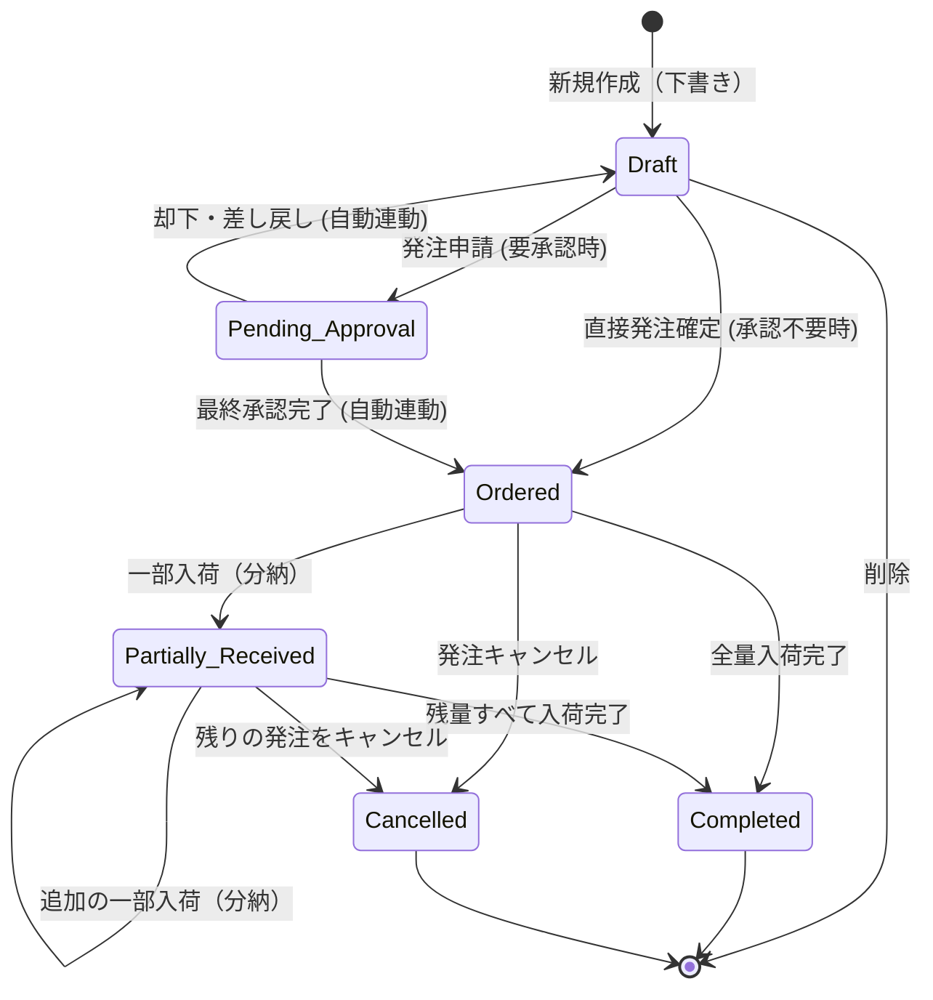

# 発注管理 機能仕様書

本ドキュメントは、取引先への注文から入荷（分納含む）までをシンプルに管理し、在庫管理および申請報告管理と連携して動作する「発注管理」機能の仕様を定義します。

---

## 1. 機能の概要と目的

Worknityの「認知負荷ゼロ」のコンセプトに基づき、日々の発注業務と在庫のズレを最小限に防ぎます。
また、他のモジュール（在庫管理、申請報告管理）と緩やかに連携することで、二重入力の手間を省きつつ、個々の企業のルール（事前承認を通すかどうか等）に柔軟に対応します。

### コア価値と連携仕様
* **アドオン連携と在庫画面への表示**
  * 本機能はアドオン（有効/無効の切り替え対象）として提供されます。
  * **発注管理アドオンが有効**、かつ**対象の商品が「発注済（未入荷）」である場合のみ**、在庫管理一覧に「発注中数量」を表示します。
* **申請報告管理とのシームレスな承認連携**
  * 稟議や購入申請が必要な組織では、発注作成画面から「発注申請」を行うことで、裏で自動的に申請データが生成され、承認依頼へ回ります。
  * 承認不要で直接発注を確定できる設定や、金額（しきい値）に応じた要承認設定をテナントごとに設定可能であり、現場の運用ルールに合わせられます。
  * 共通ワークフローエンジン（申請報告管理）側で最終承認が完了すると、発注は自動的に「発注済」に確定します。
* **分納（一部入荷）への対応**
  * 「発注した商品の一部が先に届き、残りは後から届く」という現場でよくある状況を想定し、入荷済みの数量を段階的に記録できます。
* **注文書PDFの出力**
  * システム上で作成した発注データから、取引先に送付するための「注文書（PDF）」を出力・ダウンロードできます。

---

## 2. ユースケースと業務フロー

### 2.1. 代表的なユースケース

1. **直接発注（申請・承認なし）**
   * 設定で承認が不要、もしくは設定金額未満の場合。
   * 取引先と商品、数量、単価を入力して発注データを「下書き」として作成し、そのまま「確定」させて `Ordered` (発注済) に移行。
2. **自動申請連動フロー（承認あり）**
   * 設定で承認が必須、もしくは設定金額以上の場合。
   * 発注画面で内容を入力し「発注申請」を実行すると、ステータスが `Pending_Approval` (承認待ち) になり、裏で自動的に申請報告データ（購入申請）が起票される。
   * 承認者が申請を「承認」すると、連動して自動的に発注ステータスが `Ordered` (発注済) に確定する。
   * 却下された場合は、発注ステータスが `Draft` (下書き) に戻り、修正して再申請できる。
3. **分納による段階入荷**
   * 10個発注した商品のうち、本日3個が入荷したため「入荷数量: 3」で登録。
   * 在庫マスタの現在庫が `+3` され、発注中の残数は `7` になる。
   * 後日、残りの7個が入荷した際に再度入荷登録を行い、ステータスが「入荷完了」となる。

### 2.2. ステータス遷移図

---

## 3. 機能要件

### 3.1. 発注登録・管理機能
* **発注情報の登録・編集**
  * **取引先選択**: [partners](file:///home/ubuntu/worknity/_doc/データベース設計書.md#L100-L108) マスタから選択。
  * **明細行 of 追加**: [stocks](file:///home/ubuntu/worknity/_doc/データベース設計書.md#L83-L98)（在庫マスタ）から商品を選択し、発注数量、発注単価（デフォルトは在庫マスタの参考価格）を入力。
  * **希望納期・発注日**: 日付を選択可能。
  * **担当者**: ログインユーザーをデフォルトとして自動設定（必要に応じて他メンバーに変更可能）。
  * **申請報告自動連携**:
    * 発注の確定処理（申請）時、テナントごとの「発注承認設定（`order_settings`）」を確認します。
    * **承認不要の場合（または金額しきい値未満の場合）**:
      * そのまま `発注済 (ordered)` ステータスへ遷移し、発注が確定します。
    * **承認が必要な場合（または金額しきい値以上の場合）**:
      * ステータスが `承認待ち (pending_approval)` へ遷移し、発注の編集がロックされます。
      * システムが裏で自動的に申請データ（`reports`）を起票し、ポリモーフィック関連（`approvable_type = 'App\Models\Order'`, `approvable_id = order_id`）をセットして承認フローを開始します。
      * 申請データ（`attributes` JSON）には、取引先名、商品明細のサマリー、および合計金額などが自動的に格納されます。
* **ステータス制御**
  * `下書き (draft)` 状態のみ、発注内容の編集・削除が可能。
  * `承認待ち (pending_approval)` 状態では、編集および注文書PDFの出力がロックされます。
  * 連携する申請の承認完了イベントを検知すると、自動的に `発注済 (ordered)` に遷移し、ロックが解除されて注文書PDFが出力可能になります。
  * 申請が却下・差し戻しされた場合、自動的に `下書き (draft)` に戻り、再度編集・再申請が可能になります。

### 3.2. 注文書PDF出力機能
* **PDFダウンロード**
  * ステータスが `発注済 (ordered)` 以降の発注データについて、取引先送付用の「注文書PDF」を生成してダウンロードできる。
  * 注文書には、自社情報（組織名）、取引先情報、発注日、希望納期、発注番号、明細（商品名、数量、単価、小計、合計金額）が記載される。

### 3.3. 入荷（分納）処理機能
* **入荷実績の登録**
  * `発注済 (ordered)` または `一部入荷済 (partially_received)` の発注に対し、入荷処理を行う。
  * 明細商品ごとに「今回入荷した数量」を入力する。
  * **在庫自動加算＆ログ記録**:
    * 入荷を確定すると、入力された数量分だけ `stocks.quantity`（現在庫）が加算される。
    * [stock_logs](file:///home/ubuntu/worknity/_doc/データベース設計書.md#L110-L123) に自動で履歴が追加され、操作種別は「発注入荷」として記録される。その際、どの発注からの入荷かを追跡できるようにする。
  * **ステータス自動判定**:
    * 全明細商品の「入荷済数量」の累計が「発注数量」と一致した場合 ➡ ステータスを `入荷完了 (completed)` に変更。
    * 一部の商品のみ、または発注数量に満たない入荷の場合 ➡ ステータスを `一部入荷済 (partially_received)` に変更。

### 3.4. 在庫管理画面との連携（発注中数量の表示）
* **発注中数量（未入荷数）の計算**
  * 対象商品において、以下の条件に合致する発注明細の `(発注数量 - 入荷済数量)` の合計値を「発注中数量」とする。
    * 発注ステータスが `発注済 (ordered)` または `一部入荷済 (partially_received)` であること。
  * **表示の制御**:
    * システム設定で「発注管理アドオン」が有効化されている場合のみ、在庫管理一覧および詳細画面にこの「発注中数量」を表示する。
    * 例：`在庫数: 15 (発注中: 10)` といった視認性の高いUIで表現する。

---

## 4. 権限設計
* 管理者 (`admin`): 発注の登録、変更、キャンセル、PDF出力、入荷処理のすべての操作が可能。
* スタッフ (`staff`): 発注の一覧閲覧、PDF出力、入荷処理が可能（発注の新規登録・変更・キャンセルは不可）。
* ゲスト (`guest`): 自社（取引先IDが一致する）宛ての発注一覧の閲覧およびPDFのダウンロードのみ可能。
