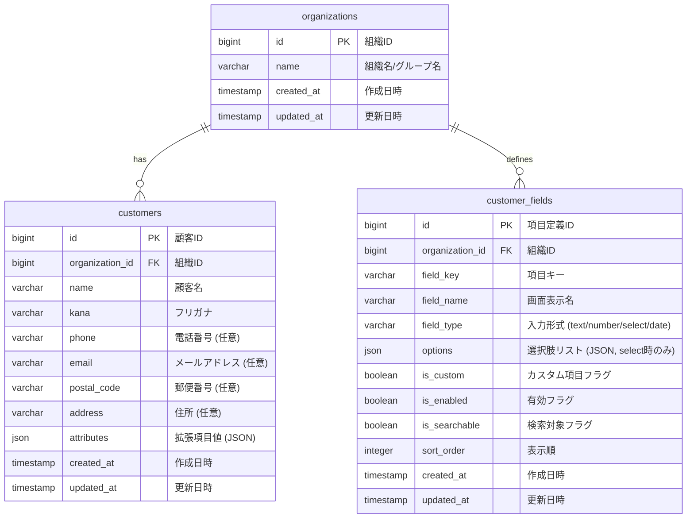

# 顧客管理 データベース設計書

本書は、ミニマリスト業務統合サービス「Worknity」における顧客管理に関連するテーブルの物理構造、リレーションシップ、インデックス設計、およびスキーマ変更（マイグレーション）内容を定義するものである。

---

## 1. 顧客管理データベース設計概要

本機能は、マルチテナント構成下において、異なる業種（介護、サロン等）の多様な入力項目に対応するため、以下の設計方針（**パターンB**）に基づいてデータを管理する。

1. **基本項目の物理カラム化 ＋ nullable（ヌル許容）:**
   - 顧客の名前（`name`）、フリガナ（`kana`）に加え、標準項目（電話番号 `phone`、メール `email`、郵便番号 `postal_code`、住所 `address`）は個別の物理カラムとして `customers` テーブルに実装する。
   - ただし、住所等を必要としないテナント（店舗）も存在するため、標準項目はすべて `nullable`（NULLを許容）とする。
2. **拡張項目（カスタム項目）のJSON格納（`attributes`）:**
   - 業種固有の拡張項目（例: 「介護度」「髪質」など）は、個別の物理カラムを追加せず、`customers` テーブルの `attributes`（JSON型）カラムに格納する。
3. **項目設定メタデータテーブルの追加（`customer_fields`）:**
   - テナントごとにどの項目を表示するか、また独自の項目をどう定義するかを管理するため、`customer_fields` テーブルを追加する。
4. **マルチテナント隔離とインデックス:**
   - 常に自社のデータのみを高速に取得するため、`organization_id` を先頭に配置した複合インデックスを各テーブルに設定する。

---

## 2. ER図（Entity Relationship Diagram）

顧客管理に関連するテーブルの関連性は以下の通りである。



---

## 3. テーブル詳細設計

### 3.1. `customers` テーブル（顧客マスタの拡張）
すでに存在する `customers` テーブルに `kana`, `postal_code`, `address`, `attributes` 等を追加します。

#### カラム定義
| No | 物理名 | 論理名 | 型 | 長さ | Null | Key | デフォルト | 説明 |
| :--- | :--- | :--- | :--- | :--- | :--- | :--- | :--- | :--- |
| 1 | `id` | 顧客ID | BIGINT | 20 | NO | PK | - | 自動採番 (Unsigned) |
| 2 | `organization_id` | 組織ID | BIGINT | 20 | NO | FK | - | `organizations.id` への外部キー (Unsigned) |
| 3 | `name` | 顧客名 | VARCHAR | 255 | NO | - | - | 顧客の名前（必須） |
| 4 | `kana` | フリガナ | VARCHAR | 255 | NO | - | - | 顧客名のかな表記（五十音順ソート用） |
| 5 | `phone` | 電話番号 | VARCHAR | 50 | YES | - | NULL | 連絡先電話番号（任意） |
| 6 | `email` | メールアドレス | VARCHAR | 255 | YES | - | NULL | メールアドレス（任意） |
| 7 | `postal_code` | 郵便番号 | VARCHAR | 20 | YES | - | NULL | 郵便番号（任意） |
| 8 | `address` | 住所 | VARCHAR | 255 | YES | - | NULL | 住所（任意） |
| 9 | `attributes` | 拡張項目値 | JSON | - | NO | - | (empty) | カスタム項目のキーと値を格納する（デフォルト `{}`） |
| 10 | `created_at` | 作成日時 | TIMESTAMP | - | YES | - | NULL | レコード作成日時 |
| 11 | `updated_at` | 更新日時 | TIMESTAMP | - | YES | - | NULL | レコード更新日時 |

#### インデックス・外部キー制約
* **外部キー制約：**
  * `fk_customers_organization_id` : `organization_id` -> `organizations(id)` (ON DELETE CASCADE)
* **インデックス：**
  * `idx_customers_org_kana` : `(organization_id, kana)` (テナント内での五十音順ソート・前方一致検索の超高速化用)
  * `idx_customers_org_phone` : `(organization_id, phone)` (電話番号での逆引き検索高速化用)

---

### 3.2. `customer_fields` テーブル（項目設定テーブル）
テナントごとの項目有効化状態および、追加カスタム項目の定義を保持するテーブル。

#### カラム定義
| No | 物理名 | 論理名 | 型 | 長さ | Null | Key | デフォルト | 説明 |
| :--- | :--- | :--- | :--- | :--- | :--- | :--- | :--- | :--- |
| 1 | `id` | 項目定義ID | BIGINT | 20 | NO | PK | - | 自動採番 (Unsigned) |
| 2 | `organization_id` | 組織ID | BIGINT | 20 | NO | FK | - | `organizations.id` への外部キー (Unsigned) |
| 3 | `field_key` | 項目キー | VARCHAR | 50 | NO | - | - | JSONや物理列とマッピングする半角英数字キー |
| 4 | `field_name` | 画面表示名 | VARCHAR | 100 | NO | - | - | 画面上のラベル名 |
| 5 | `field_type` | 入力形式 | VARCHAR | 20 | NO | - | - | `text`, `number`, `select`, `date` |
| 6 | `options` | 選択肢リスト | JSON | - | YES | - | NULL | 選択式の場合の選択肢の配列（例：`["要介護1", "要介護2"]`） |
| 7 | `is_custom` | カスタム項目か | TINYINT | 1 | NO | - | 1 | 0:システム標準, 1:テナント追加 |
| 8 | `is_enabled` | 有効フラグ | TINYINT | 1 | NO | - | 1 | 0:非表示, 1:表示 |
| 9 | `is_searchable` | 検索対象フラグ | TINYINT | 1 | NO | - | 1 | 0:検索対象外, 1:検索窓を表示 |
| 10 | `sort_order` | 表示順 | INTEGER | - | NO | - | 0 | 画面描画時のソート順 |
| 11 | `created_at` | 作成日時 | TIMESTAMP | - | YES | - | NULL | - |
| 12 | `updated_at` | 更新日時 | TIMESTAMP | - | YES | - | NULL | - |

#### インデックス・外部キー制約
* **外部キー制約：**
  * `fk_cust_fields_organization_id` : `organization_id` -> `organizations(id)` (ON DELETE CASCADE)
* **一意制約（Unique Key）：**
  * `uk_cust_fields_org_key` : `(organization_id, field_key)` (同一テナント内でのキー重複を防止)
* **インデックス：**
  * `idx_cust_fields_org_sort` : `(organization_id, sort_order)` (画面レンダリング時のソート用)

---

## 4. データベース調整 DDL（マイグレーション）

すでに存在する `customers` テーブルに対する列追加、および新規テーブルの作成SQL。

```sql
-- 1. 既存の customers テーブルの拡張
ALTER TABLE `customers`
ADD COLUMN `kana` VARCHAR(255) NOT NULL AFTER `name`,
ADD COLUMN `postal_code` VARCHAR(20) NULL AFTER `email`,
MODIFY COLUMN `phone` VARCHAR(50) NULL AFTER `kana`,
ADD COLUMN `attributes` JSON NOT NULL AFTER `address`;

-- インデックスの追加
ALTER TABLE `customers`
ADD INDEX `idx_customers_org_kana` (`organization_id`, `kana`),
ADD INDEX `idx_customers_org_phone` (`organization_id`, `phone`);

-- 2. 新規項目設定テーブルの作成
CREATE TABLE `customer_fields` (
    `id` BIGINT UNSIGNED AUTO_INCREMENT PRIMARY KEY,
    `organization_id` BIGINT UNSIGNED NOT NULL,
    `field_key` VARCHAR(50) NOT NULL,
    `field_name` VARCHAR(100) NOT NULL,
    `field_type` VARCHAR(20) NOT NULL,
    `options` JSON NULL,
    `is_custom` TINYINT(1) NOT NULL DEFAULT 1,
    `is_enabled` TINYINT(1) NOT NULL DEFAULT 1,
    `is_searchable` TINYINT(1) NOT NULL DEFAULT 1,
    `sort_order` INT NOT NULL DEFAULT 0,
    `created_at` TIMESTAMP NULL DEFAULT NULL,
    `updated_at` TIMESTAMP NULL DEFAULT NULL,
    CONSTRAINT `fk_cust_fields_organization_id` FOREIGN KEY (`organization_id`) REFERENCES `organizations` (`id`) ON DELETE CASCADE,
    UNIQUE KEY `uk_cust_fields_org_key` (`organization_id`, `field_key`),
    INDEX `idx_cust_fields_org_sort` (`organization_id`, `sort_order`)
) ENGINE=InnoDB DEFAULT CHARSET=utf8mb4 COLLATE=utf8mb4_unicode_ci;
```

---

## 5. 検索クエリとパフォーマンスガード

### 5.1. 複合検索時の動的クエリ構築

フロントエンドから渡された検索パラメータ（基本項目および拡張項目）に応じ、バックエンドで以下のように安全にバインドしたクエリを組み立てます。

```php
// 例: テナントID = 10 の顧客を絞り込む場合
$query = Customer::query()->where('organization_id', 10);

// 1. フリガナ前方一致 (ソートインデックス使用)
if ($request->filled('kana')) {
    $query->where('kana', 'like', $request->kana . '%');
}

// 2. 住所部分一致 (物理カラム部分一致)
if ($request->filled('address')) {
    $query->where('address', 'like', '%' . $request->address . '%');
}

// 3. カスタム項目（JSON）での絞り込み
// 例: 「介護度」キーが指定されている場合
if ($request->filled('care_level')) {
    $query->where('attributes->care_level', $request->care_level);
}
```

### 5.2. パフォーマンス保証
* 顧客テーブルに対して検索・ソートを行う際、インデックス `idx_customers_org_kana` を用いて、まず `organization_id` で絞り込まれた上で `kana` を使ってソートまたは前方一致検索が行われます。
* そのため、レコード総数が10万件であっても、自社の顧客数（数千〜数万件）のインメモリ検索になり、JSON値に対する評価（`attributes->key`）も遅延なくミリ秒単位で完了します。
